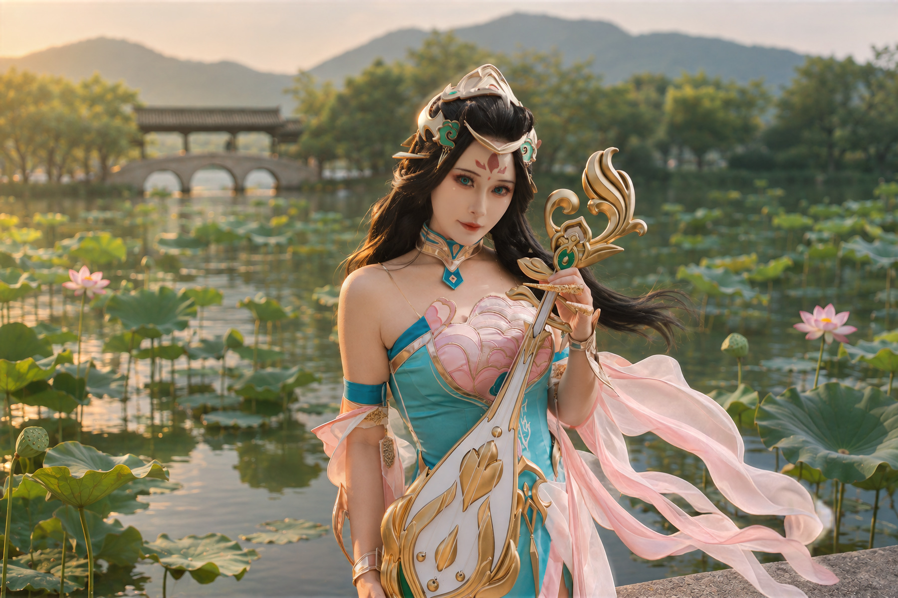
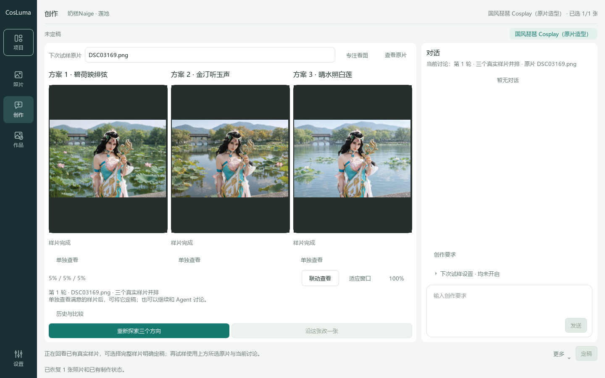
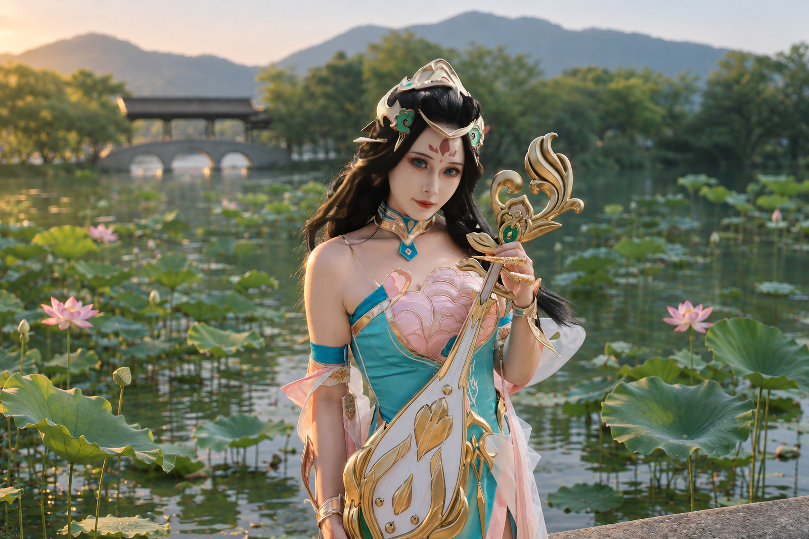
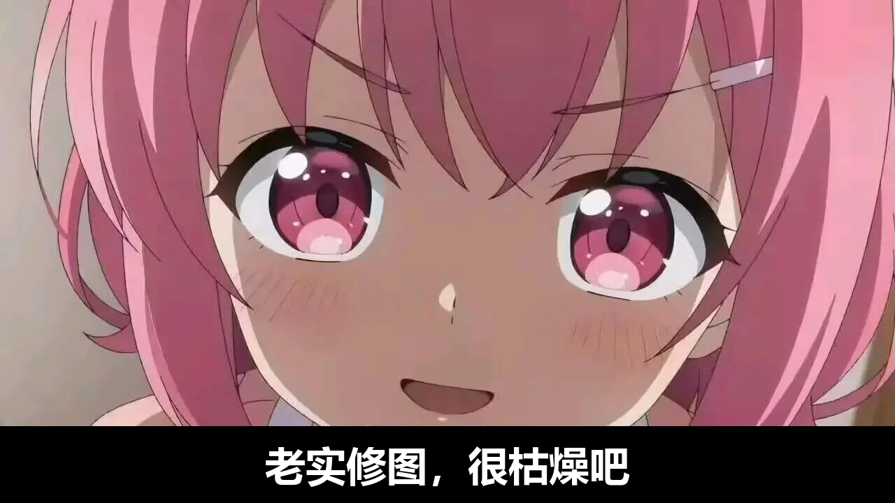

# CosLuma

A photo-editing workspace for cosplay photography. Discuss a look, compare samples and finish a batch, with manual adjustments when needed.

[Download for Windows](https://github.com/Magnus0100/cosluma/releases/tag/v0.47.0) · [Getting started](#getting-started) · [简体中文](README.md)

Windows 64-bit · Chinese interface · 0.47.0

| Original | Finished photograph |
| :---: | :---: |
|  |  |

The finished version includes scene editing, subject relighting, hair editing and clothing motion. Cosplayer: **奶糕Naige on Douyin**, shown with permission for this project's README.

## Compare samples before choosing a look

| Lotus pond | Golden light | Clear water |
| :---: | :---: | :---: |
|  |  |  |

Three initial samples from the same original, with hair editing, relighting and face beauty disabled.

## How it works

1. **Choose photographs:** import photos and character information, then check the photos to process.
2. **Describe the look:** discuss the setting and mood, compare three samples and choose a direction.
3. **Finish the set:** produce the batch, retouch as needed, compare saved versions and export.



## Keep editing the finished photograph

| What to adjust | What you can do |
| --- | --- |
| Light and color | Adjust exposure, warmth, saturation and brightness, including batch changes; relight the complete frame after local edits |
| Face | Select a face and control skin retouching and slimming yourself |
| Hair and clothing | Paint the part to edit, style strands or add flowing fabric |
| Delivery | Keep originals and saved versions; choose the PNG or JPEG to export |

Hair editing and subject relighting are optional. Clothing motion is a separate edit after production. You initiate generation, saving and adoption.

After saving hair or clothing edits, select that version and open **Light and color → Relighting**, or request relighting and saving in its chat. The model sees the complete frame, including the added content. Unsaved manual tone changes are excluded.

<details>
<summary>See hair editing and relighting separately</summary>

| Hair editing only | Subject relighting only |
| :---: | :---: |
|  |  |

These are full-image revisions of the lotus sample, so background details also change. Hair editing retains the original face, ears and physical headwear; disabling it retains the original whole head. Relighting coordinates the person, clothing, props and environment.

</details>

<details>
<summary>Usage and retouching details</summary>

Common images, HEIC / HEIF and camera RAW are supported. Checkboxes choose the production set, row highlighting controls preview, and the representative original is selected separately. Batches process four photos concurrently by default and save each independently.

For face beauty, select and analyze a face, explicitly generate a skin base, then adjust skin retouching and slimming. Both strengths start at zero; returning to zero restores the base.

Hair repair uses a detail view with full-photo context and writes back only inside the selection. Strand styling and clothing motion generate from the complete photograph and extract the actual old and new part silhouettes. Blue strokes protect regions to retain. Appearance references and shape marks are optional. All three local tasks use Qwen-Image-2.1 or MiniMax-H3-Image as selected in connection settings.

After generation, adjust the selection and explicitly recompose to reuse the existing output. Changes to text, marks or references save a draft; another generation requires an explicit action. Browsing, page changes and project restoration do not call models.

Delivery copies existing saved files. New edits do not automatically replace the chosen delivery version.

</details>

<p align="center">
  
</p>

## Getting started

Download `CosLuma-0.47.0-windows-x64.zip`, extract the complete archive and open `CosLuma/CosLuma.exe`. Enter service addresses and credentials in Connections, then create a project and import photos.

**Photography-assistant, image-editing, and segmentation / upscaling services must be configured before use.** The desktop package includes the runtime, with models and weights configured separately. Connection settings fetch model lists automatically, with manual entry available. Remote services receive the photos and prompts sent to them.

## Configuration and technical details

<details>
<summary>Connections and deployment</summary>

| Connection | Service requirements |
| --- | --- |
| Photography assistant | Chat Completions with images, tool calls and JSON output |
| Image editing | Multipart `image[]` edits, accepting an original and a style reference, returning an image URL or `b64_json` |
| Segmentation and upscaling | ComfyUI with SAM3.1, an upscale model and standard job interfaces |

Template: [settings.example.json](providers/settings.example.json). Configuration defaults to `~/CosplayWorkbench/config/cosluma.json`, overridable with `--config` or `COSLUMA_CONFIG`. Projects default to `~/CosLuma/projects/`. Keep models, photographs and private configuration outside the repository. Credentials can use environment variables or separate files.

<details>
<summary>Version 0.47.0 desktop models, weights and inference parameters</summary>

Basic ComfyUI uses `models/checkpoints/sam3.1_multiplex_fp16.safetensors` and `models/upscale_models/4xNomos2_hq_atd.safetensors`. Apply the [SAM3 text-encoder projection patch](providers/patches/comfyui-sam3-clip-projection.patch) if the service lacks that fix.

For optional features, copy the corresponding `providers/comfyui_cosluma_*` directory into the service's `custom_nodes/`, install required dependencies in its existing Python and restart. Service nodes need separate updates; weights are not bundled with the desktop application.

The Qwen node accepts up to five images, keeping the clean source and painted instructions separate.

| Feature / node directory | Default model and parameters |
| --- | --- |
| Relighting / `comfyui_cosluma_relight` | PIXLRelight + Marigold-IID-Lighting v1.1; 512 analysis canvas, BF16 network, one-step FP16 Marigold, float32 light fields, `cuda:0`, seed 42 |
| Beauty / `comfyui_cosluma_beauty` | Full BeautyGRPO LoRA + official FluxKontextPipeline; 1024 input, 28 steps, guidance 2.5, seed 42; FGTBT WFLW 98 landmarks and FaceXFormer skin parsing |
| Local editing / `comfyui_cosluma_local` | Qwen-Image-2.1 INT8 ConvRot, BF16 Qwen3-VL 8B / VAE; 1024 area resolution, 40 steps |
| Local editing / `comfyui_cosluma_h3` | MiniMax-H3-Image INT8 ConvRot, Qwen3-VL 32B NVFP4 AWQ, FP16 VAE; 2048 area resolution, 6 steps |

Qwen / H3 use cfg 1, Euler/simple and seed 42. Area resolutions 1024 / 2048 represent roughly 1 MP / 4 MP. Actual requests account for the original-size region and single-upscale factor.

| Directory | Qwen weights | H3 weights |
| --- | --- | --- |
| `models/diffusion_models/` | `qwen_image_2.1_int8_convrot.safetensors` | `minimax_h3_image_pruned_int8_convrot.safetensors` |
| `models/text_encoders/` | `qwen3vl_8b_bf16.safetensors` | `qwen3vl_32b_minimax_h3_nvfp4_awq.safetensors` |
| `models/vae/` | `qwen_image_2.1_vae_bf16.safetensors` | `minimax_h3_image_vae_fp16.safetensors` |

Select the local engine with `local_edit.engine`; H3 parameters are under `local_edit.h3`. Store weights on an NVMe SSD and configure ComfyUI's `extra_model_paths.yaml`. Both engines use the service's DynamicVRAM to memory-map encoder and diffusion weights, releasing models between stages. Qwen VAE uses 512 tiles with 64 overlap; H3 VAE decode uses resident CUDA weights. Hair-repair context has a maximum long edge of 1536. Qwen receives a mask reference; H3 does not. H3 results use gradient-domain blending.

BeautyGRPO uses `models/diffusers/FLUX.1-Kontext-dev/`, `models/loras/beautygrpo.safetensors` and analysis weights `models/cosluma_face/{facexformer,fgtbt}.safetensors`, extracted with the [FaceXFormer](providers/convert_facexformer.py) / [FGTBT](providers/convert_fgtbt.py) converters. Default `beauty.memory=bnb_nf4`: Transformer NF4 / double quant / BF16 compute, full BF16 T5 with Accelerate CPU offload, BF16 CLIP / VAE. The `cuda` layout keeps the full model in VRAM. `beauty.analysis_device` selects analysis placement; generation uses `cuda:0`. Windows beauty services set `PYTORCH_ALLOC_CONF=backend:native` and `PYTORCH_CUDA_ALLOC_CONF=backend:native`, using `--disable-dynamic-vram --disable-cuda-malloc`.

Relighting uses `models/cosluma_relight/pixlrelight` (upstream source, `model.safetensors`, `config.yaml`) and the adjacent `marigold-iid-lighting-v1-1` directory. The node also requires `addict==2.4.0` and OmegaConf. Set `relight.device` explicitly to `cuda:0` or `cpu`. Model downloads in connection settings provides files and installation commands. Weight licenses are listed in [LICENSES](LICENSES/README.md).

</details>

</details>

<details>
<summary>Showcase dimensions and native-pixel crops</summary>

The opening result passes the complete composite, including edited hair and clothing, into its final relighting step. The example was made in stages through existing interfaces. Full-frame relighting of saved versions is available from 0.47.0.

The original and saved result are 6000 × 4000. Base generation and clothing editing each produce 1536 × 1024 images, with one 4× model upscale and downsampling where needed in each stage. Final PIXLRelight estimates fields on a 512 analysis canvas and modulates the full-size float32 composite; lighting-reference RGB does not replace its detail. A subsequent 0.2 EV exposure adjustment uses the tone tool. Outputs are an sRGB 16-bit PNG and matching JPEG. Full photographs on this page are reduced copies. Face beauty was not used.

Unresized 640 × 640 crops: [original](docs/images/readme/original-face.png) · [finished result](docs/images/readme/finished-face.png).

</details>

<details>
<summary>Production chain and image quality</summary>

Base chain: direction and references → prompt writing and independent review → full-image generation → one upscale if needed → SAM3.1 original identity extraction → SIFT similarity alignment → MKL color matching or PIXLRelight → float32 mask compositing → optional luminance curve → save.

Final relighting uses the selected Qwen / H3 engine and prompt writing with independent review. The generated reference is registered to the saved frame with a SIFT similarity transform before PIXLRelight estimates its light fields. Native float32 photo pixels receive only lighting modulation, with no warping, generated detail replacement or upscaling. Separate 16-bit PNG and JPEG files retain the parent version; adoption remains explicit.

Desktop and CLI share [finish_photo / finish_batch](scripts/photo_pipeline.py). Main chat calls registered photography tools. Prompts follow [task templates](providers/generation_templates.json) with independent-context review, reusing the photography-assistant connection. Non-generative edits use fixed algorithms. The application calls Python APIs directly; external model services use HTTP. Failures retain outputs and errors without automatic retries or model switching.

Originals are read-only. The default requested long edge is 6000. Original identity RGB and masks share one transform and sampling pass. Compositing uses float32; output is a 16-bit PNG with an sRGB profile and an 8-bit JPEG. Model and some mask stages include 8-bit processing. Insufficient upscale coverage is saved at the actual supported size. Full-image revisions can alter unspecified regions; local edits write only inside the final mask. Hair, transparent fabric and large geometric changes can produce segmentation or blending seams.

</details>

<details>
<summary>Run from source and build</summary>

Use an existing Python 3.12 environment, with model services deployed separately:

```powershell
python -m pip install -r scripts/requirements-desktop.txt
python -B scripts/qt_workbench.py
```

CLI commands: `styles`, `stylize`, `compose`, `beautify`. Place global `--root` and `--config` before the subcommand. Desktop packages expose `CosLuma.exe --cli`. To build, install `scripts/requirements-build.txt`, then run `python -m PyInstaller --noconfirm CosLuma.spec`. Development rules: [AGENTS.md](AGENTS.md).

</details>

## License

Code: [GPL-3.0-or-later](LICENSE). The project is noncommercial and nonprofit. Third-party code, models and weights retain their own licenses; see [LICENSES/README.md](LICENSES/README.md). Photographs, derived images and photographs within screenshots are authorized for this project's README display only and are not relicensed under the code's GPL.
