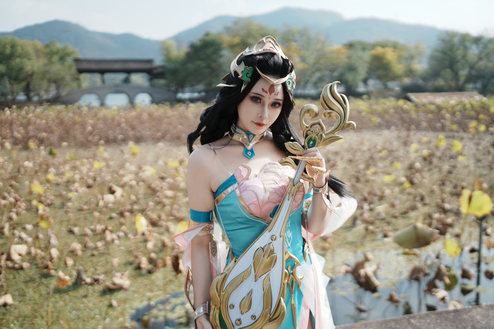
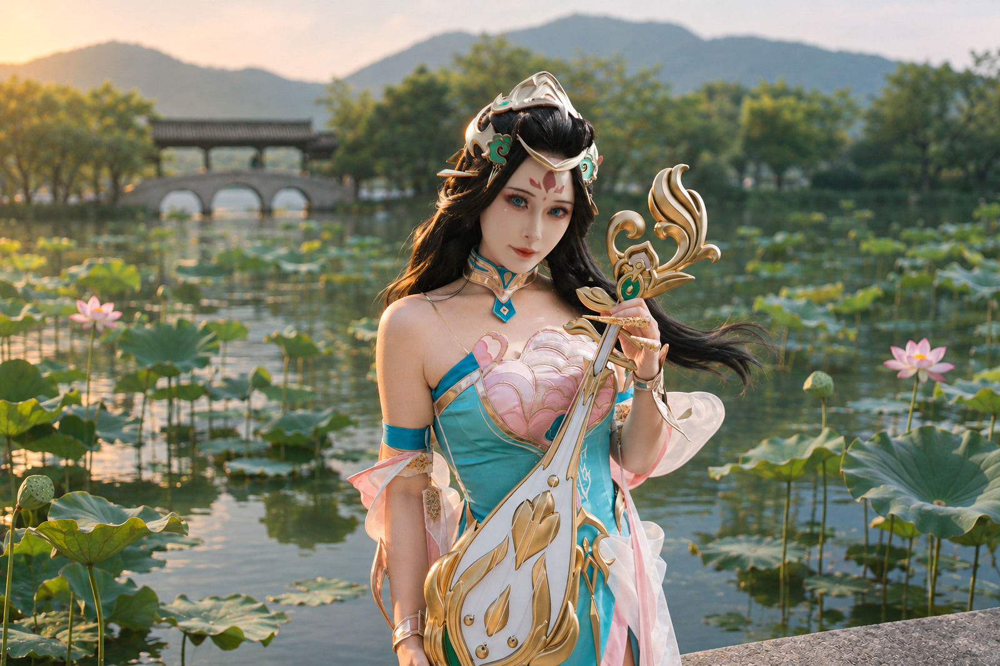
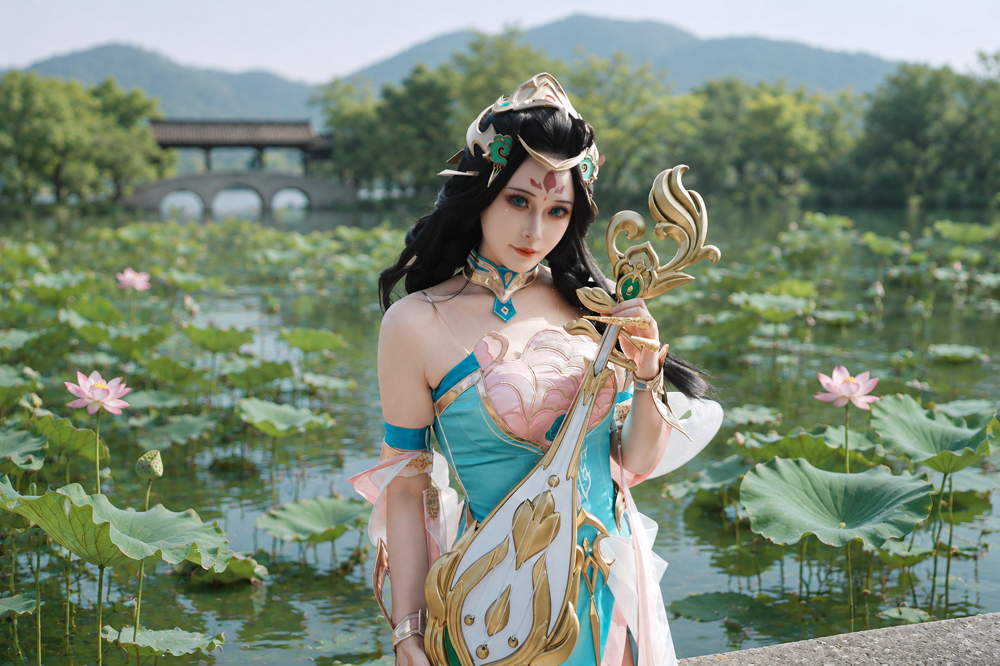
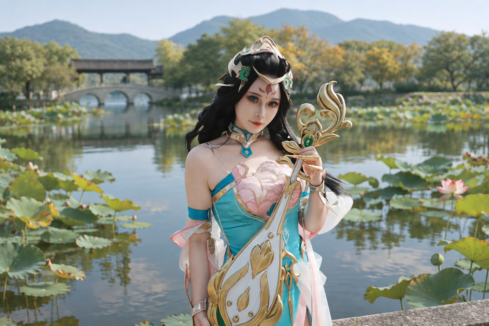
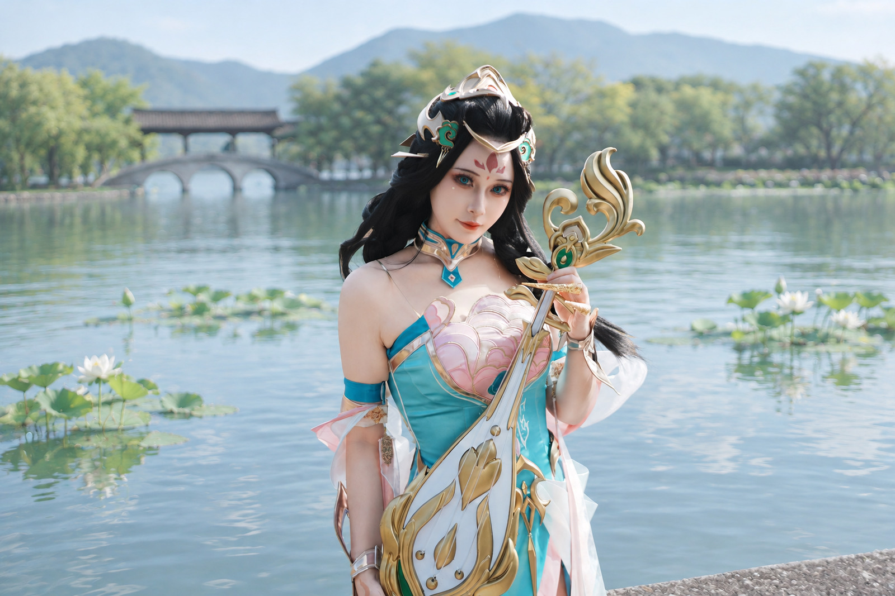
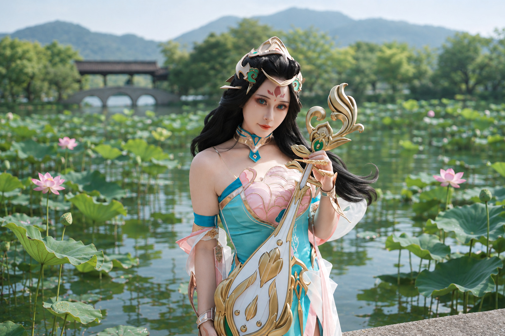

# CosLuma

A post-production workspace for cosplay photography. Create samples and finish batches through conversation, with manual retouching and version selection.

[Download for Windows](https://github.com/Magnus0100/cosluma/releases/tag/v0.44.0) · [简体中文](README.md) · [Getting started](#getting-started) · [Deployment](#deployment) · [Licenses](LICENSES/README.md)

Windows x64 · Chinese interface · Source **0.46.0** · Download **0.44.0** (does not include all current source changes)

| Original | Finished · hair editing and relighting enabled |
| :---: | :---: |
|  |  |

Cosplayer: **奶糕Naige on Douyin**, shown with permission for this project's README.

## Features

| Feature | Use |
| --- | --- |
| Samples and batches | Discuss requirements, explore three real samples, then reuse the approved direction and references for a batch |
| Identity preservation | Extract the original identity region, align with a similarity transform and blend light and color |
| Hair editing and relighting | Two independent base-production options, disabled by default |
| Tone and face | Fixed-algorithm color adjustments; optional skin retouching and face slimming, starting at zero strength |
| Hair and clothing | Repair hair, style strands or add clothing motion on a saved version |
| Versions and delivery | Compare, save and choose delivery versions; copy existing PNG / JPEG files |

Chat and manual controls share processing functions. Browsing, page changes and project restoration read saved records. Users initiate generation, saving, adoption and export.


## Results

| 碧荷映绯弦 · Green lotus | 金汀听玉声 · Golden shore | 晴水照白莲 · White lotus |
| :---: | :---: | :---: |
|  |  |  |

Three base samples from the same original, with hair editing, relighting and face beauty disabled.

| Hair editing only | Subject relighting only |
| :---: | :---: |
|  |  |

These are full-image revisions of the lotus sample, so background details also change. Hair editing retains the original face, ears and physical headwear; disabling it retains the original whole head. Relighting coordinates the person, clothing, props and environment.

<details>
<summary>Dimensions and native-pixel crops</summary>

Examples come from actual production: a 6000 × 4000 original, 1536 × 1024 native generation, then one 4× model upscale and downsampling to a 6000 × 4000 16-bit PNG and matching JPEG. Full photographs on this page are reduced copies. Saved-photo beauty and local retouching were not used.

Unresized 640 × 640 crops: [original](docs/images/readme/original-face.png) · [base result](docs/images/readme/result-face.png) · [relighting only](docs/images/readme/relight-face.png) · [hair editing and relighting](docs/images/readme/hair-relight-face.png).

</details>

## Getting started

Download `CosLuma-0.44.0-windows-x64.zip`, extract the complete archive and run `CosLuma/CosLuma.exe`. The package includes Python and image-processing dependencies. Model services and weights are configured separately.

| Required connection | Requirements |
| --- | --- |
| Photography assistant | Chat Completions with images, tool calls and JSON output |
| Image editing | Multipart `image[]` edits, accepting both an original and a style reference, returning an image URL or `b64_json` |
| Segmentation and upscaling | ComfyUI with SAM3.1, an upscale model and standard job interfaces |

1. **Create a project:** configure connections, import photographs and enter the character. Common images, HEIC / HEIF and camera RAW are supported.
2. **Select originals:** check the production set and separately choose a representative photograph. Row highlighting controls preview only.
3. **Make samples:** discuss requirements, optionally enable hair editing or relighting, then explore three directions.
4. **Approve and produce:** adopt a sample and process checked photographs, four concurrently by default, saving each result.
5. **Retouch and deliver:** compare and edit in Works, choose delivery versions and export existing files.

Connection settings fetch model lists from the address and credentials; manual entry is also available. Remote services receive the photographs and prompts sent to them.

### Editing saved photographs

Open an editor from the selected saved version. Results are saved separately, retaining the parent.

| Edit | Scope and controls |
| --- | --- |
| Tone | Full-image exposure, warmth, green–magenta tint, saturation and luminance curve; batch application to delivery-checked photos |
| Face beauty | Select and analyze a face, explicitly generate a skin base, then adjust skin and slimming; zero restores the base |
| Hair repair and exposed-wig coverage | Detail editing with full-photo context, written back only inside the selection |
| Strand styling and clothing motion | Full-image generation; extract actual old and new part silhouettes, excluding original foreground and user protection |

All three local tasks use Qwen-Image-2.1 or MiniMax-H3-Image as selected in connection settings. Painting identifies the original part; shape marks and appearance references are optional. The model determines new silhouettes from the full photograph. Blue strokes protect regions to retain.

After generation, users can adjust the mask and explicitly recompose from the existing output. Text and reference changes save drafts; generation requires another explicit action. Clothing motion is a separate saved-photo edit.

## Deployment

Template: [settings.example.json](providers/settings.example.json). Configuration defaults to `~/CosplayWorkbench/config/cosluma.json`, overridable with `--config` or `COSLUMA_CONFIG`. Projects default to `~/CosLuma/projects/`. Keep models, photographs and private configuration outside the repository. Credentials can use environment variables or separate files.

<details>
<summary>Models, weights and inference parameters</summary>

Basic ComfyUI uses `models/checkpoints/sam3.1_multiplex_fp16.safetensors` and `models/upscale_models/4xNomos2_hq_atd.safetensors`. Apply the [SAM3 text-encoder projection patch](providers/patches/comfyui-sam3-clip-projection.patch) if the service lacks that fix.

For optional features, copy the corresponding `providers/comfyui_cosluma_*` directory into the service's `custom_nodes/`, install required dependencies in its existing Python and restart. Service nodes need separate updates; weights are not bundled with the desktop application.

| Feature / node directory | Default model and parameters |
| --- | --- |
| Relighting / `comfyui_cosluma_relight` | PIXLRelight + Marigold-IID-Lighting v1.1; 512 analysis canvas, BF16 network, one-step FP16 Marigold, float32 light fields, `cuda:0`, seed 42 |
| Beauty / `comfyui_cosluma_beauty` | Full BeautyGRPO LoRA + official FluxKontextPipeline; 1024 input, 28 steps, guidance 2.5, seed 42; FGTBT WFLW 98 landmarks and FaceXFormer skin parsing |
| Local editing / `comfyui_cosluma_local` | Qwen-Image-2.1 INT8 ConvRot, BF16 Qwen3-VL 8B / VAE; 1024 area resolution, 40 steps |
| Local editing / `comfyui_cosluma_h3` | MiniMax-H3-Image INT8 ConvRot, Qwen3-VL 32B NVFP4 AWQ, FP16 VAE; 2048 area resolution, 6 steps |

Qwen / H3 use cfg 1, Euler/simple and seed 42. Area resolutions 1024 / 2048 represent roughly 1 MP / 4 MP. Actual requests account for the original-size region and single-upscale factor.

| Directory | Qwen weights | H3 weights |
| --- | --- | --- |
| `models/diffusion_models/` | `qwen_image_2.1_int8_convrot.safetensors` | `minimax_h3_image_pruned_int8_convrot.safetensors` |
| `models/text_encoders/` | `qwen3vl_8b_bf16.safetensors` | `qwen3vl_32b_minimax_h3_nvfp4_awq.safetensors` |
| `models/vae/` | `qwen_image_2.1_vae_bf16.safetensors` | `minimax_h3_image_vae_fp16.safetensors` |

Select the local engine with `local_edit.engine`; H3 parameters are under `local_edit.h3`. Store weights on an NVMe SSD and configure ComfyUI's `extra_model_paths.yaml`. Both engines use the service's DynamicVRAM to memory-map encoder and diffusion weights, releasing models between stages. Qwen VAE uses 512 tiles with 64 overlap; H3 VAE decode uses resident CUDA weights. Hair-repair context has a maximum long edge of 1536. Qwen receives a mask reference; H3 does not. H3 results use gradient-domain blending.

BeautyGRPO uses `models/diffusers/FLUX.1-Kontext-dev/`, `models/loras/beautygrpo.safetensors` and analysis weights `models/cosluma_face/{facexformer,fgtbt}.safetensors`, extracted with the [FaceXFormer](providers/convert_facexformer.py) / [FGTBT](providers/convert_fgtbt.py) converters. Default `beauty.memory=bnb_nf4`: Transformer NF4 / double quant / BF16 compute, full BF16 T5 with Accelerate CPU offload, BF16 CLIP / VAE. The `cuda` layout keeps the full model in VRAM. `beauty.analysis_device` selects analysis placement; generation uses `cuda:0`. Windows beauty services set `PYTORCH_ALLOC_CONF=backend:native` and `PYTORCH_CUDA_ALLOC_CONF=backend:native`, using `--disable-dynamic-vram --disable-cuda-malloc`.

Relighting uses `models/cosluma_relight/pixlrelight` (upstream source, `model.safetensors`, `config.yaml`) and the adjacent `marigold-iid-lighting-v1-1` directory. The node also requires `addict==2.4.0` and OmegaConf. Set `relight.device` explicitly to `cuda:0` or `cpu`. Model downloads in connection settings provides files and installation commands. Weight licenses are listed in [LICENSES](LICENSES/README.md).

</details>

<details>
<summary>Production chain and image quality</summary>

Base chain: direction and references → prompt writing and independent review → full-image generation → one upscale if needed → SAM3.1 original identity extraction → SIFT similarity alignment → MKL color matching or PIXLRelight → float32 mask compositing → optional luminance curve → save.

Desktop and CLI share [finish_photo / finish_batch](scripts/photo_pipeline.py). Main chat calls registered photography tools. Prompts follow [task templates](providers/generation_templates.json) with independent-context review, reusing the photography-assistant connection. Non-generative edits use fixed algorithms. The application calls Python APIs directly; external model services use HTTP. Failures retain outputs and errors without automatic retries or model switching.

Originals are read-only. The default requested long edge is 6000. Original identity RGB and masks share one transform and sampling pass. Compositing uses float32; output is a 16-bit PNG with an sRGB profile and an 8-bit JPEG. Model and some mask stages include 8-bit processing. Insufficient upscale coverage is saved at the actual supported size. Full-image revisions can alter unspecified regions; local edits write only inside the final mask. Hair, transparent fabric and large geometric changes can produce segmentation or blending seams.

</details>

<details>
<summary>Run from source and build</summary>

Use an existing Python 3.12 environment, with model services deployed separately:

```powershell
python -m pip install -r scripts/requirements-desktop.txt
python -B scripts/qt_workbench.py
```

CLI commands: `styles`, `stylize`, `compose`, `beautify`. Place global `--root` and `--config` before the subcommand. Desktop packages expose `CosLuma.exe --cli`. To build, install `scripts/requirements-build.txt`, then run `python -m PyInstaller --noconfirm CosLuma.spec`. Development rules: [AGENTS.md](AGENTS.md).

</details>

## License

Code: [GPL-3.0-or-later](LICENSE). The project is noncommercial and nonprofit. Third-party code, models and weights retain their own licenses; see [LICENSES/README.md](LICENSES/README.md). Photographs, derived images and photographs within screenshots are authorized for this project's README display only and are not relicensed under the code's GPL.
