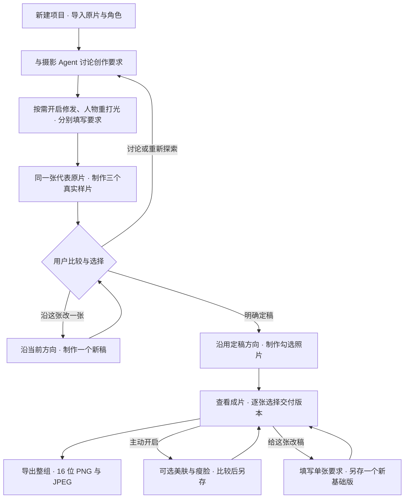

# CosLuma

**Windows x64 · 源码使用 Python 3.12 · 本地最近验证的包为 0.27.2 · 公开下载为 0.25.3**

当前维护的源码以本地 0.27.2 为基础，并包含尚未打包进发布产物的维护修正；本地最近验证过的 Windows 包仍是 0.27.2，公开下载仍是 0.25.3。本文描述这套源码当前的产品行为、部署参数与模块入口：源码、实际运行结果与桌面发布版的差别在对应位置说明，未打包的修正不写成已发布或已由新包验证。
当前默认四张并行，请求长边默认 6000，保存带 sRGB 配置的 16 位 PNG 与同一结果的 8 位 JPEG。成片后的局部修饰默认使用 Qwen-Image-2.1；MiniMax-H3-Image 是可选项，不会自动启用或自动替换已有结果，其权重、精度与推理参数自 0.27.0 起未变，现有真实样片没有证明它普遍优于 Qwen，限制见局部修饰章节。模型节点需按对应章节更新并重启服务。

按项目整理一组照片和角色，与摄影 Agent 讨论创作方向，比较同一张原片的三个真实样片，由用户定稿后再制作整组 COS 摄影后期；保留本人五官、脸型和相机细节。创作时可独立开启修发与人物重打光，两项默认关闭。

## 制作流程



首次探索的三个方向由 Agent 结合本次角色、原片与讨论设计。方向接近预期时，可单独查看完整样片后点击“沿这张改一张”，结合当前讨论只制作一个新稿；需要重新探索时仍生成三个方向。定稿后，批量沿用选中的方向和真实样片；制作范围包含样片原片时直接复用该成片。美化在基础成片保存后由用户主动打开。

每张真实样片与其余原片共用同一条制作链：

**原片与摄影方向、可选设置 → 按单张构图写提示词 → 整图生图 → 必要时一次模型超分 → SAM3.1 提取原片身份保留区 → SIFT 整体等比对齐 → MKL 仿色或已开启的空间光照迁移 → 一次浮点蒙版融合 → 可选明度曲线 → 保存。**

## 下载与首次使用

本地最近验证的 Windows 包名为 `CosLuma-0.27.2-windows-x64.zip`，完整解压后打开 `CosLuma/CosLuma.exe`；同提交源码包名为 `CosLuma-0.27.2-source.zip`，使用同目录 `SHA256SUMS.txt` 核对文件。0.27.2 尚未公开发布，下面的下载链接仍指向 0.25.3，其中没有 0.26.0 起的重打光、FGTBT 与可选 H3 引擎局部修饰。

[下载 Windows 包](https://github.com/Magnus0100/cosluma/releases/download/v0.25.3/CosLuma-0.25.3-windows-x64.zip) · [Release 与校验文件](https://github.com/Magnus0100/cosluma/releases/tag/v0.25.3)

Windows 用户下载 Release 中的 `CosLuma-0.25.3-windows-x64.zip`，完整解压，打开 `CosLuma/CosLuma.exe`。
包内已有 Python、桌面和图像处理依赖，源码 ZIP 用于开发，不是可直接双击运行的 Windows 包。

**软件是模型服务的桌面客户端。首次出片需要你自己的图文提示词服务、图像编辑服务，以及已部署分割和超分模型的 ComfyUI。**
包内不含这些服务、权重或账号；使用远端服务时需要网络，照片与提示词会发送到配置的服务。

1. 打开软件先进入项目页，点击“新建项目”填写名称与保存位置，或“打开项目”选择已有 `project.json`。
   新项目尚无配置、照片和已有批次时，显示欢迎页，说明讨论、样片与整组制作的顺序。
   点击“开始配置”，或通过“导入已有配置”选择 JSON；软件使用原配置文件，不复制或覆盖它。
   也可选择“先整理照片，稍后配置”，该选择本机保存。照片页保留直接进入配置的提示，已有配置的项目直接进入工作室。
2. 配置按“摄影 Agent → 整图生图 → 分割与超分 → 核对与保存”引导，每步说明服务用途。
   摄影 Agent 使用支持图片输入与工具调用的图文模型，整图生图使用支持原片与风格参考输入的图像编辑模型。
   地址可填写到 `/v1`，保存时补全兼容接口路径；也可填写完整接口地址。模型名以实际服务为准。
   “下一步”检查当前填写内容，缺项或地址格式错误时直接定位对应字段；也可点击左侧步骤回看修改，输入保留。
   两个接口由同一服务提供时，可沿用摄影 Agent 的地址和凭据，再填写图像模型名；超分可主动沿用分割的 ComfyUI 地址。
   图像参数已有值时默认展开，也可手动展开填写；留空才不发送该项，收起只隐藏填写区，不清除已填参数。
3. 服务密钥可直接粘贴到密码框。保存时写入用户配置目录内的独立密钥文件，配置 JSON 只记录路径。
   已有的环境变量和密钥文件可继续使用，编辑设置不会读取或显示原密钥。
4. 最后核对四项服务，项目内可选择本项目照片结果的保存文件夹；软件内置 260 条分类摄影参考，无需下载、选择或复制词库文件。
   分割与超分步骤可直接打开对应模型的下载方法；左侧“模型下载”列出所需文件、上游下载页、安装位置和可复制的 PowerShell 命令。
   “查看服务部署说明”打开随包 README；可选美肤和瘦脸在出片后再设置，其连接设置也提供美化模型下载入口。
   保存后进入照片页，通过“批量导入”添加照片或文件夹，勾选准备制作的照片，也可先用“Agent 帮我选片”整理，再填写角色并进入“创作”页。
   创作页缺照片或尚未勾选时，可直接批量导入或返回照片选片；缺角色或配置时提供“填写角色”“连接设置／导入配置”入口。照片和角色齐备后，在此保存或导入配置即显示讨论区。取消连接设置会保留原有配置和创作输入。
   选择代表原片，与 Agent 聊想法，点击“探索三个方向”。单独查看接近预期的完整样片，讨论修改后可“沿这张改一张”；将满意的完整样片定稿，再明确点击批量制作。“成片”页查看结果，进入“项目作品 / 交付”选择版本，可“给这张改稿”后再决定是否采用新版本，最后整组导出。

设置只保存本机文件，不连接服务。主动选片、发送讨论、试样、改稿或批量制作时才调用对应服务，错误会显示在对应步骤，不自动重试或换模型。
默认配置位于 `~/CosplayWorkbench/config/cosluma.json`；参考词库直接读取包内 `providers/prompts.json`，不在用户配置目录创建副本。
已有配置明确指定的自定义词库继续使用，也可在连接设置最后一步点击“改用内置参考库”；保存后生效，原词库文件保留。
**配置目录可能包含密钥文本，请勿公开或上传。** 凭据文件只在调用对应服务时读取，不写入制作记录。

## 日常制作

### 按项目管理拍摄

每个项目对应一组独立创作，包含照片队列、勾选与代表原片、角色与补充要求、选片建议、对话与草稿、历轮样片、定稿、制作批次、交付选择与导出记录。
项目有独立标识，同一角色的棚拍与外景可以分别建项目，创作要求互不沿用。

“项目”页列出最近打开的项目，可按名称或角色搜索，预览代表原片及已有成片，查看照片数、成片数、批次数与最近编辑时间；已有交付选择时也显示交付张数与导出次数。
点击“继续创作”恢复这个项目上次的照片、创作或成片页；“打开项目”可选择其他位置的 `project.json`。
项目列表读取记录后只保留名称、数量、说明和预览路径等展示摘要，不让其他项目的完整照片队列与选片建议长期驻留；当前打开项目仍使用完整记录。刷新列表时重新读取项目，打开项目恢复全部原有内容，不另外建立摘要文件。
可在项目页“重命名”，或在项目内点击顶部项目名称修改名称；重命名只改变显示名称，已有目录与文件保持原位置。
每次启动先显示项目页，打开项目不调用模型、不自动继续制作。

新项目默认保存在 `~/CosLuma/projects/<项目名称>/`，`project.json` 保存项目记录，选片、讨论、样片与批次默认放在该目录的 `work` 中；可选择其他保存位置。
原片只引用原路径，不复制或修改。项目记录使用本机路径，原片与已记录的工作目录应保留在这些位置。
服务配置与凭据仍在本机配置目录，项目文件不包含密钥，也不复制服务配置；不同项目复用当前服务连接。

返回项目页或切换项目时保存当前创作、美化草稿与交付选择；保存失败保留当前项目并显示错误。导入、选片、讨论、试样、改稿、批量、美化或交付导出仍在运行时，可查看项目列表与当前项目各页，处理结束后再切换项目。
“新建项目”始终从空白创作开始，不导入弃用方案的工作区状态。

项目内的“照片”“创作”“成片”位于同一个工作室，可随时切换。照片页整理原片与角色，创作页讨论和试样，成片页浏览当前或已有批次。
切换页面保留当前照片、对话、草稿与已有样片，不发起模型调用，也不会自动开始制作。
在项目页拖入照片或文件夹时，先新建一个项目再导入；取消新建不会把照片加进此前打开的项目。

照片页的“批量导入”菜单提供“选择照片（可多选）”和“导入文件夹”，也可同时把多张照片与多个文件夹拖入窗口。
支持 JPEG（JPG/JPEG/JPE/JFIF）、PNG、TIFF、WebP、BMP、HEIC/HEIF（含 HIF 扩展名），以及 rawpy/LibRaw 支持的相机 RAW（ARW、CRW/CR2/CR3、NEF/NRW、ORF、RAF、RW2/RWL、DNG、PEF、SRW、SR2/SRF）；具体机型取决于随包 LibRaw 的支持。
不同像素尺寸、横图、竖图和方图可以混合导入，不用预先统一分辨率；读取拍摄朝向并转换为 sRGB。预览和 Agent 分析按用途缩小，主图制作读取完整原片，PNG/TIFF 的 16 位及 HEIC/HEIF 的 10/12 位数据不先压成 8 位。
HEIC/HEIF 使用主图，附属深度图、HDR 增益图与实况视频不参与制作；当前交付为 sRGB 静态照片。
“包含子文件夹”默认关闭，开启后才递归导入。导入文件夹或同时拖入多个文件夹都遵循此选项，直接多选照片不受影响。
软件在后台整理导入，按路径去重，原片只读；完成后说明新增、重复和不支持的项目数量，并保留当前预览。选错照片可以“移除高亮照片”或清空。
新加入的照片默认全部勾选，列表的勾选决定实际进入创作、试样和批量制作的照片；“全选”“全不选”可统一调整，也可逐张勾选。
行高亮用于预览或“移除高亮照片”，不会替你改变制作勾选。未勾选的照片仍留在列表，已有讨论、样片和定稿也保留。
调整勾选、全选／全不选和设置代表原片时只更新相关表格内容，保留当前行、高亮与滚动位置，不主动重载未更换的预览；导入、移除照片或应用新选片建议时再按实际队列更新列表。
在预览下点击“设为试样原片”指定代表，列表的 ★ 标记当前代表；点看其他照片不会更换它。

可在“选片要求”填写希望保留的数量、近景与全身覆盖等要求，也可留空，然后主动点击“Agent 帮我选片”；角色可以等选片后再填写。
Agent 使用全部导入照片的编号缩略总览，给出逐张取舍建议、理由和推荐代表原片，只调用已配置的图文提示词服务。
成功后直接应用建议勾选，其他照片仍保留，你可以继续手工调整勾选和代表原片。选片是可调整的创作取舍，不打分，也不作为成片质量门禁；选片本身不生图、不定稿、不开始批量。
预览区分别显示 Agent 建议和当前勾选；有选片记录时，可用“打开选片记录”查看对应结果目录。
列表编号对应上次选片总览，后续新增且尚未分析的照片标为“新”，移除照片不会改写已有建议的编号。
追加照片默认勾选，不自动重新选片；选片失败保留已有勾选并显示实际错误，不自动重试。
编号总览使用 8 位缩略图，适合比较构图、姿态和画面覆盖，不能据此判断全部原像素细节。

照片队列、勾选、选片要求、建议与代表原片、子文件夹导入选项、当前预览、角色与补充要求、已有完成和失败状态会自动保存到当前项目；重开项目恢复查看。
移除或清空后重新添加的照片作为新加入处理，重开软件也不会从旧批次重新带回完成状态。
上次制作中断的照片显示“未完成”，不自动继续、重试或提交。新加入且尚未制作的照片仍可单独制作；
需要重新处理已提交的照片时，由用户明确选择“勾选照片另做一批”。原片移走后保留队列记录并说明缺失，可移除后重新添加。

进入创作前角色为必填，补充要求可以留空。候选方向在收到角色和勾选照片后设计，没有固定风格菜单。
LLM 结合角色的可靠设定、原片妆造与道具、构图和受光决定方向；不了解的角色设定不编造，依据用户输入与可见素材设计。
讨论、摄影方向设计与单张提示词默认保留原片服装和道具；只有用户明确要求修补、补齐或还原具体部件时才处理。角色常识与参考词库不能自行换装或替换道具。
提示词库提供摄影参考，不把库条目直接变成预设候选。桌面把前面的讨论与试样留给用户和 Agent 一起完成：

1. 勾选准备制作的照片，确认 ★ 标记的代表原片后进入“创作”页。创作页沿用这个代表，画布先显示原片，右侧是聊天区；上方“下次试样原片”可更换下次重新探索的输入，并同步照片页的代表选择，不改变“沿这张改一张”所依据的样片原片。点击“查看原片”可在画布查看它，已有轮次保留。
2. 在聊天区表达想法、询问建议、比较已有方案，或针对样片提出修改。用户消息记录发送时的原片、样片轮次、方案、改稿前对照样片及实际查看方式，并在消息旁显示；切换轮次后，历史消息仍保留当时讨论的对象。
   Agent 保留全部已成功对话和历史样片说明；本次附图只带当前候选、定稿、实际查看的改稿前对照样片，以及最近一次成功发送的用户消息当时可见样片。较早样片仍可按历史标识明确引用为风格参考；未附图时，Agent 不据说明声称看到了细节。
   对话只调用图文提示词服务，不提交照片制作；用户与 Agent 的消息分开显示，回复中的创作要求位于输入框上方。支持 Ctrl + Enter 发送，也可先试样，再结合实际画面讨论。
   Agent 的建议先留在对话中，只有你明确修改要求或采纳视觉建议时，“当前创作要求”才更新；普通询问、比较和未采纳的建议不改变已有要求。后续明确要求覆盖最初补充要求中的冲突。
   要求发生更新时，回复下方显示“本次要求更新依据”和本条用户原话，并随对话保存。程序核对该引用确实来自本条消息；缺少对应引用时显示错误，保留原要求与输入草稿，由你修改后再发送。引用核对用于确认来源，不能保证模型对询问、引用和采纳的语义判断始终正确。
   “当前创作要求”旁可点“编辑要求”直接保存或清空完整要求，也可“撤回更新”逐次恢复最近更新前的内容；两项均不调用模型，对话、已有样片、定稿和输入草稿保留。操作作为用户消息保存，撤回的更新标明已撤回，后续讨论按恢复后的当前要求继续。修改后按当前要求试样再定稿；恢复到已有定稿的要求与设置且没有未发送草稿时，可继续使用该定稿。运行中两个操作锁定，重开项目恢复；缺少更新前内容的旧记录不能直接撤回，可通过“编辑要求”自行修正。
   向上阅读旧消息时，新回复不会打断阅读；点击“查看最新消息”或自行滚到底部恢复跟随，主动发送问题时显示最新消息。每条用户和 Agent 消息可点“复制”取得完整原文，也可选取部分文字复制。
   输入自动保存为草稿，切页或重开后可以继续。尚未发送的内容会明确提示，先发送给 Agent 或清空输入，再按已讨论的要求试样、定稿和批量制作。
   发送失败时，对话保留“你（发送失败）”、原文和真实错误，切页或重开后仍可查看；原文也留在输入框，修改后由你再次发送，不自动重发。
   草稿暂时暂停批量，不删除已有定稿；清空草稿且创作要求未变时，仍可使用原定稿。
3. 点击“探索三个方向”时，软件固定本次已成功对话、当前创作要求和相关原片、真实样片，交给 LLM 结合角色与提示词库，设计三个适合当前素材的不同方向。
   明确要求以某张真实样片为基础修改时，可沿用该样片的摄影风格，其 JPEG 通过第二张生图输入提供参考；第一张仍是这轮原片。仅浏览或比较不会自动采纳某张样片，人物身份与头部仍只来自原片。
   三张样片使用同一张原片，各自完整执行整图编辑、必要时一次超分、整头回贴和保存，不是滤镜示意或临时背景。
4. 三个候选显示在画布下方的缩略图条，各自展示制作进度。点击缩略图在主画布查看，默认显示成片，也可主动切换原片或并排对比；点击“专注看图”在页内展开同一画布，再点击“返回讨论”回到聊天与样片。
   点击“三个样片并排”，同时查看这一轮三个方向的完整真实样片，右侧保留聊天。默认“联动查看”同步缩放与拖动位置，可关闭后分别查看；“100%”查看原始像素，“适应窗口”分别显示完整画面，横竖图按各自比例呈现。
   点击某个方向的“单独查看”展开该样片，比较原片和成片后可明确定稿。“返回单张查看”恢复此前查看的方案；比较本身不选择方向、不改变已有定稿。失败或未完成的样片在原位置显示状态与真实错误，后续样片完成时更新对应画布。
   方向名称与说明来自本次设计，说明画面、光感、氛围与适合这组素材的理由。照片区与聊天区可拖动中间分隔条调整宽度。
   样片会调用实际配置的模型；失败的方案显示真实错误并保留文件，不自动重试，也不能被当作完整样片选择。
5. 可以继续跟 Agent 聊哪张接近预期、哪些地方需要修改。单独查看一张完整样片时，点击“沿这张改一张”，使用该样片的原片、已设计方向、具体参考与 JPEG 风格参考，结合当前已成功讨论、创作要求和主动设置的修发、重打光要求，只制作一个新稿，不重新规划方向。上方“下次试样原片”不改变本次改稿依据；原片仍是生图第一张输入，所沿用样片是第二张风格参考，身份与回贴仍来自原片。
   新稿单独保存为只有一个样片的轮次，原样片与文件保留，完成后由你查看并明确定稿，不自动采纳。处于原片、定稿对照或多个样片并排查看时，先单独查看要修改的完整样片。
   在单张改稿轮次勾选“与改稿前样片并排”，左侧显示本次改稿依据的样片，右侧显示当前稿；模式下拉框也可单独查看任一侧。取消勾选恢复与原片比较，不改变下次试样原片、当前要求、输入草稿或定稿。
   需要重新探索不同方向时，点击“重新探索三个方向”，使用上方所选原片与当前讨论。修改创作要求后，原有样片仍可对比或明确作为改稿依据，定稿使用符合当前要求的完整样片；普通询问和比较沿用当前要求。
   从“样片轮次”下拉框按“第 N 轮 · 原片名”回看本次创作此前的候选、完整样片及对应原片；运行中的轮次标记“制作中”，等待时也可回看旧轮。
   回看不改“下次试样原片”、当前创作要求、对话、草稿或定稿；重新探索使用上方所选原片，沿样片改稿使用眼前完整样片的原片，两者均纳入当前讨论与显式设置。
   与当前要求一致的完整旧样片也可明确选中定稿；要求不同的旧轮仍可查看，不会自动恢复旧要求。
6. 满意后，将当前查看的完整样片定稿。软件保存讨论要求、最终方向和对应样片；Agent 不代替用户定稿。
   定稿后进入本次制作，创作画布与对话仍保留。批量按钮旁显示已定稿的真实样片、方向名称和代表原片；“查看定稿”回到对应样片。
   浏览其他方案只切换预览，不改变已定稿方案。明确点击批量制作后才提交其余勾选原片，沿用定稿方向，不继续讨论或另行设计风格。
   勾选包含样片原片时，直接复制选中的完整样片收进本批次，不再生成一次；其余照片沿用该方向和具体参考，不再次规划风格。

后续 LLM 和生图均收到选中的真实样片作为风格参考；原片是第一张生图输入，样片是第二张输入。
本张的头部定位、人物身份、构图和姿态仍只依据本张原片，样片不参与身份回贴。
场景、材质、配色和光质保持一致，各张按实际受光、动作和情绪细化，特效按单张决定，允许不加。
重新探索的三个样片并行，“沿这张改一张”只制作一张；选定后的批量默认四张并行，其余每张只执行一次，单张失败不影响其他照片。
修改角色或补充要求后重新生成并选择；同一要求下追加照片可沿用当前定稿。
照片页的勾选同步决定创作页可用的原片；追加照片默认勾选，已有对话、草稿、样片和定稿保留，代表原片也可手动更换。
已选样片保留其制作时的实际尺寸，后续尺寸设置应用于新制作照片；如需改变样片本身尺寸，可明确重新生成。
重开项目会恢复对话、代表原片选择、当前创作要求、已有样片和定稿，也恢复上次查看的方案、比较对象、查看模式、三个样片并排与联动开关；缩放位置重新适应窗口。查看已有内容不调用模型。
Agent 回复、试样、改稿或批量制作时，可以切页查看原片和已有成片，也可最小化等待；照片、角色、补充要求与服务配置在运行时暂停编辑。
服务错误在聊天区或对应照片显示，保留输入和已生成文件，不自动重新发送。

照片列表逐张显示实际制作阶段；批量运行时，下方进度条显示已处理张数，不是估算完成时间。完成、失败与未完成数量在成片列表旁汇总。
点击任一行可查看原片预览、成片或失败原因。照片页和成片页有完整结果时默认并排对比原片与成片，也可切换为单独查看；
预览在后台读取原始显示分辨率，只加载当前单张或并排实际需要的图片；读取时仍可操作窗口，快速切换照片只继续加载当前选择。
滚轮缩放、按住鼠标拖动查看，点击“100%”检查像素细节；
点击“适应窗口”、双击画布或按 0 恢复全图，画布中按 1 查看 100%，加减键缩放。
并排默认“联动查看”，按画面比例同步缩放和查看位置，适合不同分辨率的原片与成片；关闭后可分别检查。
工具栏“100%”让两侧各自按原始像素显示；联动只对应画面中的相对位置，不补偿生成画面的构图或人物位移。
可打开原片或此照片的工作文件夹。照片页和成片页均提供“打开 JPEG”和“打开 16 位 PNG”，直接打开选中结果的查看副本或 PNG 成片。
分割前或整组方向设计失败时，也能打开本批次文件夹查看已保留文件。
RAW 的预览、选片与制作均由 rawpy/LibRaw 解码；其他格式共用图像读取模块，读取失败时显示实际错误。分析预览不参与整头回贴。

完成后添加新照片，主按钮变为“按选定风格制作新增 N 张”，只制作当前勾选的新增照片，已有成功与失败照片都不自动重做；同一要求下沿用当前选定方向。
“勾选照片另做一批”只将当前勾选的照片重新提交为新批次，未勾选照片的已有结果和状态保留；勾选包含样片原片时，仍复用选中的完整样片。原有结果另存保留。
“成片”页在同一窗口浏览当前制作和已有批次，直接读取保存的成片、失败原因与未完成状态；
“查看已有批次”菜单中的“本项目的制作批次”保留当前项目历次批量制作，可直接选择回看。
可输入原片文件名的一部分搜索（也可包含扩展名，不区分大小写），并叠加“全部 / 完成 / 失败 / 未完成”状态筛选；列表显示当前匹配数量与整批总数。
搜索框的清空按钮移除文件名条件，选择“全部”取消状态筛选；没有匹配照片时显示空态，不保留上一张预览。
浏览已有批次不替换当前照片队列、不发起模型请求。也可选择其他包含 `batch.json` 的批次文件夹，查看更早或另存的结果。
查看已有批次时，当前队列的定稿和制作操作收起；点击“回到本次制作”回到本组结果，尚未开始时回到待制作状态。
完整移动批次文件夹后仍按其中的相对位置查找成片；缺失的原片或成片会明确显示，不把未完成结果标为完成。

### 项目作品与交付

在“成片”页点击“项目作品 / 交付”，用缩略图总览本项目历次制作的完整成片。同一原片只占一个位置，失败和未完成记录继续在对应批次查看。
点击缩略图查看大图，并用滚轮、100% 和拖动检查细节；缩略图在后台读取。
右侧“交付版本”包含这张原片历次制作的基础成片及所有已另存的美化版，标明制作序号、修发与重打光状态和美肤、瘦脸强度；悬停可查看当时的具体修发、光照要求。美化草稿不作为交付版本。
“比较对象”可选择原片或同一原片的任一已保存版本，直接并排比较修发、光照或美化前后的结果；左右标签标明各自版本。
切换比较对象只改变查看，交付仍使用右侧明确选择的版本；同一照片的同尺寸版本切换保留缩放与查看位置。
左侧是已保存版本时，可点击“采用左侧为交付”明确采用，原交付版本移到左侧，方便继续比较或再次采用；交付勾选保留，不调用模型。原片不能作为交付版本，右侧“交付版本”下拉框仍可直接选版。
可从当前作品打开可选人脸美化，另存后回到项目作品页，再明确选择是否交付新版本。

需要修改其中一张时，点击“给这张改稿”打开窗口，在同一原片已保存的基础版本中选择改稿依据，并填写这张照片的具体要求。从美化版打开时，默认使用其对应基础版，改稿不继承美化。选择改稿依据不切换右侧交付版本，文字与选项草稿按所选基础版本保存。摄影方向与具体参考沿用所选依据；修发、重打光初始沿用该基础版的实际设置，可在窗口中明确为这张新稿调整，补发需主动开启修发。以原片为身份和回贴依据、所选基础成片为风格参考，只制作一个新基础版。
继续改稿会继承所选父版本已采纳的单张要求，冲突处以最新要求为准，不读取其他版本分支。单张要求不改项目当前创作要求、定稿或其他照片。新稿另存为独立制作批次，旧结果、交付版本与勾选保留；完成后点击“比较新稿”将新稿放到左侧查看，右侧仍是原交付版本，是否采用由你明确决定。
两种改稿仍由模型编辑整图，没有提供局部蒙版，未指定修改的区域也可能变化；要求保留某处是创作约束，不是像素锁定。浏览或填写要求本身不制作，明确提交后才调用服务；失败显示实际错误、保留已生成文件，不自动重试。

1. 勾选要交付的作品。交付勾选独立于照片页的制作勾选，新作品默认不勾选，默认预览最近一次基础成片。
   文件名搜索与“只看已选交付”可叠加；“勾选当前显示”“取消当前显示”只调整当前筛选中可见的作品，点击预览本身不改变勾选。
2. 为每张作品选择要交付的具体版本。之后新增制作或美化版会保留此前选择，不自动换成最新版本；只浏览、改版本和勾选均不调用模型。
3. 选择 JPEG（8 位）、PNG（16 位）或两者，点击“导出所选 N 张”，选择保存位置。
   每次创建新的 `<项目名称>_交付_<时间>-<标识>/` 文件夹，按原片名保存到 `JPEG`、`PNG` 子目录，重名自动加序号。
   导出直接复制所选版本已保存的文件，保留其像素、位深与色彩配置，只包含所选成片；原片、基础版本、美化历史和制作中间文件保留原位置。

勾选、逐张交付版本与比较对象、联动开关、格式、保存位置、当前作品与导出记录自动保存在本项目 `project.json`；重开项目恢复交付页和选择，缩放重新适应窗口。
已保存的交付选择一直保留：某条选择对应的原片不在当前作品的批次记录中时，摘要会单独标出这些数量，它们不显示在列表里也不会被剪枝，导出时在交付记录中列出失败并说明原因，不靠删除选择来对齐计数。
下方交付记录菜单可查看历次导出的成功张数、实际错误与文件夹，并打开对应交付文件夹；不会把部分失败显示为整组完成。
所选版本或文件缺失时显示实际错误，保留已导出的文件并继续其他照片，不换用另一版本、不自动重试。

### 创作时的可选修发与人物重打光

在创作页展开“下次试样设置”，分别勾选修发与人物重打光。两项默认关闭，属于本项目当前创作要求。修发使用已有整图生图与 SAM3.1；重打光另需在连接设置的“分割与超分”页配置 PIXLRelight 服务和模型目录。
画布下方单独显示眼前样片实际使用的设置，悬停可看该轮要求；右侧设置控制下一次试样，回看旧样片时两者分别显示。

- **修发与头发生成**：填写希望修补、保留或调整的位置，例如“补齐右侧缺发，刘海和头饰保留，长发向身后扬”。也可在对话中说明。留空时按原有发型修整露网、缺口、断层与干扰杂发，不自行增加飘发。开启后头发采用生成结果；Agent 按这张原片识别花冠、发卡等具体实体头饰，SAM3.1 分别提取脸部与这些头饰，再保留原片脸部、耳朵与实体头饰。脸部蒙版内封闭的眼睛、眉毛孔洞会补齐；新增头发不跨过保留区。宽大的透光头纱随生成场景受光，明确要求保留原片头纱时才列入保留物体。头纱的外观、存在与结构默认作为衣装由生成画面保留，这不是把原片头纱当作固定身份像素回贴；是否列入保留物体只依据用户填写的补充要求、修发或光照要求、对话中已采纳的原话与本张改稿要求，Agent 归纳的摄影方向描述不算用户明确要求；该判定按名称整词匹配执行，记录保存在该张目录的 `headwear-audit.json`。未修改发束的像素也可能随生成变化，不承诺只改一根发丝。
- **人物重打光**：填写目标光感，例如“左侧暖主光，右侧承接蓝色环境反光”。留空时 Agent 根据当前摄影方向设计。整图生图共同处理面部、身体、服装、道具与背景的光向、反光和阴影；融合端使用 PIXLRelight，以同画布生成结果为 RGB 参考预测增益和偏置，再作用于整体等比对齐后的原片 float32 RGB。原片几何与细节继续参与最终合成；该步骤替换普通 MKL，不叠加旧频率分离或额外 MKL。

与 Agent 讨论后，首次探索主动生成三个真实样片；已有接近预期的样片时，可单独查看后“沿这张改一张”。比较实际修发和光照效果，再定稿用于批量。对话不会替用户打开这两个开关。
开关与具体要求保存于对话、本轮样片、定稿和逐张制作记录；改变有效设置后需要按新设置试样再定稿，与当前设置一致的完整旧样片仍可明确定稿。仅修改已关闭选项的文字不改变有效设置；旧记录缺少选项字段时表示关闭。回看旧轮不会修改当前设置。
两个选项关闭时沿用原有整头回贴与一次 MKL 仿色。批量沿用所选样片的设置，样片原片仍直接复用；整批重新制作可明确“勾选照片另做一批”，已有基础成片的单张修改可在交付页“给这张改稿”，后者初始沿用该版设置，可在窗口中明确为本张调整。旧版均保留。

PIXLRelight 在 512 方形分析画布中读取原片保留区和生成上下文，官方 Marigold-IID-Lighting 单步分解 RGB 参考。完整网络使用明确的 BF16 autocast，返回 float32 光照场；客户端仅上采样光照场，直接调制已经采样一次的原片 RGB。分析图和模型重建 RGB 均不作为身份回贴素材。原片锐利硬阴影、过曝和纯黑处仍可能残留局限；大幅生成几何偏差也会影响匹配。SAM3.1 是分割蒙版，不是逐根发丝的透明度估计，头发与头饰相贴处可能有边缘误差。
模型分析输入、生成图与分割蒙版为 8 位；光照场和最终合成为 float32，另存 16 位 PNG 不补回模型环节丢失的精度。

### 成片后的可选人脸美化

基础成片保存后，在“成片”页选中照片，点击“人脸美化”。首次填写美化服务连接，再点击“选择人脸并分析”，在整张成片上主动框选要处理的人脸范围（不受此前自动头部范围限制）；
FGTBT 直接读取选定裁片。后续恢复这张成片的当前美化草稿；打开页面和保存连接不调用模型。美化从基础成片开始，默认美肤、瘦脸均为 0，不自动用于样片或整批照片。

1. “瘦脸”可直接在 0–100 间调整，收窄下颌两侧，固定眼、鼻、嘴和外侧边界。
2. 点击“生成美肤基础”后，BeautyGRPO 生成本张人脸的调整基础；成功时从 30 的强度开始预览，可继续调到 0–100。
   “美肤保护五官”默认开启，仅调整皮肤并保留眼睛、眉毛与嘴唇；关闭后在面部轮廓内应用模型差值，允许这些部位随美肤调整。
   开关与滑杆均复用当前基础，不再请求生图；“重新生成美肤基础”是你主动另做一次，旧文件保留。瘦脸仍固定五官的位置。
   “查看模型原始输出”直接打开未经皮肤选择、强度混合或五官保护的官方推理 PNG；滑杆调节的是此后应用到成片的强度，不改模型权重或推理步骤。
3. 在“美化前 / 美化后”并排查看，也可单独切换，放大检查皮肤和妆容；滑杆更新时保留缩放。“全部归零”恢复基础成片的像素。
4. 满意后点击“另存美化版”，保存同尺寸 16 位 PNG 和同一结果的 8 位 JPEG。成片页的“美化版”勾选可随时切回基础成片；
   打开 PNG/JPEG 跟随当前版本。基础成片和批次原有 `PNG`、`JPEG` 导出目录保留。

参数、五官保护选择与美化基础保存在此照片的工作文件夹，切页或重开软件后再次进入可继续；保存前的预览是草稿，不标为已保存的美化版。
新版本位于 `beauty-*/edit-*`，`beauty-latest.json` 指向最近另存版本，历史版本不覆盖。
“美化连接”可修改服务地址与实际模型名，下一次主动分析或生成时使用；连接保存本身不调用模型。
分析或生图失败显示实际错误与文件目录，保留基础成片、已有模型文件和上次成功预览，不自动重试或换模型。

美化保持原尺寸 float32 成片作为像素基础，只叠加皮肤调整差值；瘦脸对局部采样一次。
模型输入直接从完整尺寸的成片裁取人脸，按官方方式用双线性缩放到 1024 像素、8 位 RGB；不从分析缩略图放大获得。
推理为完整 BF16，官方 PIL 输出仍为 8 位 PNG；FaceXFormer 的分析输入为 224 像素，蒙版经 8 位 PNG 传输。
16 位另存不会补回模型环节没有的色阶；生成模型也可能调整皮肤纹理，效果由你对比并选择强度。

### 成片后的局部修发、发束造型与双下巴

成片或“项目作品 / 交付”页点击“局部修发／发束／双下巴”，从当前已保存版本开始。三项任务分别保留草稿，初始没有修改范围，不自动调用模型。

1. 选择“补发与露网修补”“发束造型”或“双下巴修饰”。补发延续相邻发色与发束，不自行增加飘动；发束造型可写明方向、轮廓和幅度；双下巴仅用于下颌下方和颈部的局部修饰。
2. 用“涂选修改范围”画出允许写回的区域，粉色覆盖显示范围；“保护／擦除范围”可擦掉不应修改的位置。脸部、头饰、衣领和配饰请留在范围外。造型可另画青色形状标记，或选择发色、发束参考图；形状标记不替代修改范围。
3. 填写本次具体要求，也可留空。明确点击“生成本次修饰”后，Qwen-Image-2.1 接收源局部、单独黑白蒙版及可选标记图、参考图。它们通过多图编辑输入，蒙版属于图像条件。
4. 在“比较本次结果”中查看所选版本与本次修饰，可并排、联动或查看 100% 原尺寸。界面列出模型原生、一次超分和原尺寸写回区域的实际尺寸，可直接打开模型原始输出。模型原生结果按目标局部等比居中裁切，再下采样到该局部，不拉伸、不插值放大；原生输出覆盖不足时，复用“分割与超分”中已配置的模型超分一次，同样等比居中裁切并下采样到局部，不插值放大生成像素。软件只将涂选范围内的生成像素写回，羽化按涂选区域厚度向内收，范围外保持所选版本像素。模型原始结果另外保留。
5. 点击“另存这个修饰版本”，得到同尺寸 16 位 PNG 与 JPEG。基础和历史版本保留，交付页会列出具体任务、要求，以及所选版本已有的美化和局部修饰；新增版本不改变已有交付选择。再次修改文字或涂画后需主动生成新结果，旧文件仍保留。

涂画预览最长边 1600；模型输入、输出和蒙版为 8 位。原尺寸合成使用 float32，另存 16 位 PNG 不会增加生成区域原本没有的色阶，超分纹理也不等于相机原生细节。未配置所需超分、或一次超分仍不足以覆盖所选区域时，显示该步骤的真实错误并保留输出，可缩小范围后主动生成。草稿保存在照片工作目录的 `retouch-drafts`，每次生成位于独立 `retouch-*`，另存版本位于其中的 `edit-*`。离页释放原尺寸缓冲，回来只恢复当前流程的草稿与结果；失败显示实际错误，不自动重试或更换模型。

“打开当前批次文件夹”定位正在查看的批次。`PNG` 与 `JPEG` 子目录按原片名保存成片：
PNG 是带 sRGB 配置的 16 位结果，JPEG 是同一结果的 8 位查看副本。
不同目录原片重名时使用各自工作目录名区分，不覆盖已有文件；整理失败显示实际错误，已生成文件与已记录的整理位置保留。
新批次将每张基础成片移动到 `PNG`、`JPEG` 子目录，同一批次每种格式只保存一份；照片工作目录的 `run.json` 与批次 `batch.json` 指向该文件。
提示词、模型返回、头部裁片与蒙版仍在照片工作目录。独立单张与样片在各自工作目录保留 `final.png`、`final.jpg`，旧批次的保存方式可继续读取。
复用样片时只复制 PNG、JPEG 成片和制作记录；提示词、模型返回与头部中间文件继续引用原样片目录。
样片保存在独立的 `styles-*` 文件夹，包含 `styles.json`、三个 `style-N.json` 及各自完整工作目录；未选样片也保留。
选片结果保存在仓库外输出目录中的 `selection-*` 文件夹，包含编号总览、`selection.json` 和模型原响应。
创作对话保存在 `creative-*` 文件夹的 `conversation.json`，定稿保存为 `chosen-direction.json`，记录最终方向与选中样片的关联。
对话与样片可能包含个人内容，均存于所选仓库外输出目录。

预览按当前可见页面与查看模式读取像素：适应窗口使用最长边 2000 像素的显示预览，主动进入 100% 或放大至需要更高分辨率时，才按需读取原尺寸显示像素（显示仍为 8 位量化，不等于原片 16 位数据）；缩小到预览已能覆盖当前显示分辨率、回到适应窗口或离开页面后，释放不再需要的原尺寸显示副本。切页后释放该页画布像素，回来按需重读。
可复用的显示图片使用最多 64 MiB 的共享缓存，按最近使用淘汰；当前正在查看的图片和制作中的工作内存另计，大图可直接显示而不进入缓存。
样片阶段比较三张样片时仍按原尺寸读取这三张；这是既有行为、本版未改，不宣称所有页面都不读取原始像素。
三个样片依次解码并显示，隐藏后停止后续读取；交付缩略图只保留可见范围和相邻一行，滚动、筛选与换版时移除离开范围的图标，离开交付页清空缩略图。
离开美化页先保存草稿，当前处理结束后释放原尺寸 float32 成片与显示像素；回来读取已有美化会话并恢复预览，不重新调用分析或生图服务。切换项目清空共享显示缓存与对话附图缓存。
调整美肤与瘦脸时，只计算原尺寸人脸区域，再更新基础预览的对应显示像素，避免每次复制整张 float32 成片；100% 仍按原始像素查看。另存使用同一局部计算结果回写原尺寸 float32 成片，再保存 16 位 PNG 和 JPEG，预览不作为保存素材，归零恢复基础成片。
局部修饰仍以原尺寸 float32 成片工作：显示用预览、写回用工作 RGB，放大到需要更高分辨率或进入 100% 时按需读取原尺寸显示像素，预览不作为保存素材。H3 梯度域融合的临时浮点工作区限制在涂选包围框加一像素边界，模型结果先按与原先相同的方式落到整张尺寸再取该范围；原尺寸工作 RGB 与保存画布仍按需保留，Qwen 历史邻域色调路径不变。
保存 16 位 PNG 和制作 8 位查看副本时，按行分块转换像素，避免同时保留整张浮点转换副本；制作合成仍使用原尺寸 float32。生成美肤基础复用当前已读取的完整成片，不额外解码一份。讨论附图请求 1280 像素长边预览，支持缩小解码的格式直接读取小图；RAW 与 HEIC/HEIF 仍需先完成原格式解码再缩小。
制作链读取生成图或超分图的尺寸时只读取图片头信息，按真实朝向计算宽高；实际送入超分或合成时仍读取完整像素。输出 JPEG 与预览缩放按通道直接写入同一预分配浮点缓冲，再原位把数值裁剪到 0–1，不先按通道堆叠再裁剪整图。启用可选明度曲线时，曲线把结果直接写入合成结果已拥有的同一 float32 缓冲，不再单独分配整帧副本；未启用曲线时该步骤不执行，曲线辅助函数在未指定输出缓冲时仍返回新数组、不写入输入。
整头合成在最后一次需要完整原片时，按既有取整与裁剪规则复制一份实际头部的浮点裁片，并返回该裁片的包围框与原片尺寸，之后释放整幅原片缓冲；写回只使用这份裁片和它的原始坐标，裁片提取本身不做缩放或重新量化；后续仍沿用既有 SIFT 整体等比对齐与一次浮点采样。裁片大小取决于照片与头部占比，不是所有照片都只留下很小的缓冲，软件也不宣称移除全部整幅缓冲。
远端返回的图片改为按块写入磁盘后，下载过程不再同时保留整幅图片；内联 Base64 响应仍需整段解码，multipart 上传仍在内存中组装，所以不宣称所有网络操作都在固定内存上限内完成。
只在真正执行对应计算的那一步导入 SciPy（整头合成的蒙版孔洞处理、瘦脸形变、亮度曲线与 H3 梯度域融合）；导入后该进程内可能一直保留，不宣称离开相应页面就卸载全部库。
桌面的显示与制作内存与模型服务的内存分别计算：讨论桌面占用时区分工作集（RSS）与私有提交（private commit），两者含义不同，应分别测量，不能只以 RSS 判断系统提交压力，也都不是容量上限的保证；整体运行峰值要求见下方美化章节，那是对当前模型组合的要求，不代表 32 GB 机器即可在同一台机器宽松并行其他任务。H3 局部修饰把每个阶段所在进程的峰值写入记录：工作集是进程常驻页，含私有、共享与文件映射页，其中一部分可回收；另外记录操作系统提交量与该进程的提交峰值，提交量既不是 RSS，也不是页面文件中实际占用的字节。阶段峰值按进程分别记录，不能相加，不构成整体上限或保证。

生图接口返回 Base64 图片时，先保存并成功读取原始模型图片，再将响应记录中的该图片编码改为文件名与字节数，保留其余响应字段；读取失败保留原响应。
软件不另外建立磁盘预览缓存。原片、模型文件、历轮样片、基础成片、美化原始模型输出和已另存版本均保留，交付导出仍是用户主动创建的独立副本；这些属于项目内容，会随制作次数增长，可在不再需要时由用户整理归档。
PNG、JPEG 与 JSON 保存，以及交付复制在结束或失败时清理各自本次写入的临时文件；原成片与已成功保存的文件保留，错误照常显示。
已部署的 ComfyUI 服务独立管理自己的输入、输出；随包美肤节点在每次完整推理后释放自身的 Pipeline 和模型内存，详见下方部署说明。桌面不删除服务端文件，旧版本已产生的重复文件也不自动迁移或删除。

角色、补充要求、照片队列、请求尺寸、结果路径与创作、交付状态保存在当前项目的 `project.json`。
本机配置路径、最近项目列表和界面偏好保存在 `~/CosplayWorkbench/config/desktop.ini`；服务连接与凭据独立于项目。
“更多设置”可选择其他配置或调整本项目请求长边。
导入、Agent 回复、试样、批量制作、美化或交付导出尚未结束时关闭窗口，任务继续在系统托盘运行，点击托盘图标或菜单可返回窗口。
保持托盘状态时完成后退出；返回窗口后保留完成界面。没有系统托盘时仅最小化窗口，制作继续。

## 配置与服务部署

桌面支持直接粘贴密钥、已有文件、环境变量和无需密钥四种方式；编辑已有配置默认保留其凭据。
新密钥写入配置目录中的独立 `.key` 文件。保存成功后，只清理旧配置里实际引用过、由软件按自己的命名创建、且新配置不再引用的密钥文件；不扫描保存目录，也不删除用户自己的其他文件。
凭据文本由当前 Windows 用户配置目录保护，软件不宣称提供额外的加密保险库。

手动配置只需将 [配置示例](providers/settings.example.json) 另存为上述 `cosluma.json`，替换服务地址、模型名和凭据引用。
`prompt_library` 为 `null` 或省略时直接使用内置参考库；需使用自己的库时可在 JSON 中明确填写文件路径，文件缺失时显示错误，不替换为内置库。
自定义文件须为非空 JSON 数组，每条包含 `title`、`text` 文本与 `source` 来源（文本或对象）。
`COSLUMA_CONFIG` 或命令行 `--config` 优先于记住的路径；相对资源路径以配置文件目录为准。

### 内置参考库与按需查阅

内置库按摄影任务分为十一类：场景与空间、光源与曝光、色彩与成像、服装与道具材质、景深与背景组织、
元素特效、魔法与幻想特效、天气与光学气氛、科技与机械特效、植物与自然意象、参考分析与组照一致。
这些分类是 Agent 的资料导航，场景、方向与样片名称仍根据本次角色、原片和讨论形成，不作为固定风格菜单。

讨论和试样设计的初始请求只提供不到 600 字符的分类说明与数量，不发送全部标题或正文。
Agent 根据原片可见内容和本轮要求，按分类与摄影关键词搜索；一次最多三个分类查询，合计返回最多八条 ID、标题和短摘要。
需要借鉴时再读取其中最多四条正文，每条至多 1000 字符，较长自定义条目明确记录为节选。
查阅依次提供“搜索、读取”两个工具步骤，可以在任何一步直接回答；普通问题和已有样片比较不强制检索。
工具不联网、不生图、不修改原片，只访问当前明确配置的词库；没有相关结果时由 Agent 根据素材说明，不自动换库。

参考采用稳定 ID，定稿只保存本次实际读取并选中的少量内容与来源快照。单张提示词只携带这些选中参考；
批量沿用已定稿的方向、参考和真实样片，不重新检索整库。讨论与重新探索时使用当次词库；沿样片改稿或给交付基础成片改稿时，沿用所依据版本已保存的具体参考。旧定稿及文件保留。
查阅响应与所读内容保存在对应讨论或试样的工作目录，不把检索正文追加到后续成功聊天历史。

内置库的 COS 专用条目来自 `Couer869/cos-effect-prompt` 的特效、
光影、服装材质和电影光色参考；补充了 `nuyoah-xiezhen-prompt`、`nuyoah-image-reverse-prompt` 的可迁移摄影描述与参考分析内容。
通用库只保留适用的场景、布光、影调和短摄影节选；完整换装、换脸、商品、海报与多格版式模板不进入内置库。
每条保留来源、版本、分类、标签与摘要；改编条目标明适用范围，外部工作流、默认风格、审批和模型参数不作为执行规则。
来源及许可见 [LICENSES/README.md](LICENSES/README.md)。软件启动与制作不自动联网更新词库。

自定义条目未标注 `category` 时归入“自定义未分类参考”，同样按需搜索与读取。
可选 `category` 使用 `scene`、`lighting`、`color`、`materials`、`depth`、`effects-elements`、`effects-magic`、
`effects-atmosphere`、`effects-tech`、`effects-nature`、`reference`；`id`、`summary` 与 `tags` 可自行提供。

### 配置字段

| 配置 | 内容 |
| --- | --- |
| `llm.url`、`llm.model` | 支持图片输入与函数工具调用的 Chat Completions 兼容接口完整地址、实际模型名 |
| `image.url`、`image.model` | 接受 multipart `image[]` 的图像编辑接口完整地址、实际模型名 |
| `llm/image.api_key_file` | 密钥文本文件路径；与 `api_key_env` 二选一 |
| `llm/image.api_key_env` | 保存密钥的环境变量名；进程启动后改变变量需要重新启动软件 |
| `image.parameters` | 服务支持的额外图像参数；界面提供质量、尺寸、格式，其他项可在 JSON 中设置 |
| `head.url`、`head.model` | ComfyUI 根地址、`models/checkpoints` 中的 SAM3.1 图像分割权重名 |
| `sr.url`、`sr.model` | ComfyUI 根地址、`models/upscale_models` 中的超分权重名 |
| `prompt_library` | 默认 `null`，直接使用内置参考库；可明确指定自定义 JSON 文件路径 |
| `workers` | 并行照片数，默认 4 |
| `output_long_edge` | 请求长边，默认 6000；`null` 请求原片尺寸 |
| `finish_curve` | 可选的归一化 `[输入明度, 输出明度]` 数组，默认不调整 |
| `beauty` | 可选人脸美化的 ComfyUI 地址、模型名与明确的人脸分析设备；在美化页单独保存，未配置不影响基础制作 |
| `relight` | 可选人物重打光的 ComfyUI 地址、PIXLRelight 与 Marigold 目录、设备和种子；在连接设置中保存，创作开关独立 |
| `local_edit` | 成片后局部修饰的引擎选择 `engine`（`qwen` 或 `h3`）、Qwen 引擎的 ComfyUI 地址与三个权重文件名（顶层字段），以及可选 H3 引擎的独立配置 `local_edit.h3`；在局部修饰页单独保存 |
| `python` | 源码启动器使用的已有 Python 路径；Windows 包不使用 |

### 接口约定

`llm.url` 保存完整请求地址，客户端发送非流式 `messages`，其中图片为 `image_url` 数据 URL。
选片、讨论、方向设计和单张提示词均使用独立的 `system` 消息定义当前阶段职责与输出格式；角色、用户要求、历史讨论、参考条目及可选要求以结构化任务资料提供，不插入系统规则。来源文字、文件名和图片内文字只作素材，不能改变流程或功能开关；模型回答没有配置、下载、执行程序、定稿、批量或导出权限，这些操作由用户明确触发的软件入口执行。
服务返回 `choices[0].message.content`，文本须为模型按提示要求生成的 JSON。
参考查阅使用标准 `tools`、`tool_calls` 和 `tool_call_id`，搜索与读取各最多调用一次，仅接受分类检索词或本次已检索条目的 ID；服务须支持该协议与 `system` 消息。来源网址作为资料保留，不据其联网或读取其他文件。
最后一轮只生成当前阶段要求的 JSON，额外操作字段及未提供的工具均显示协议错误。讨论返回 `reply`、`direction_update`、`direction_evidence`；更新依据须逐字来自本条用户原文，无更新时后两项均为 null。实际错误保留原响应并显示，不重发，也不改成全量词库输入。
`image.url` 接受 multipart `image[]` 和文本字段 `model`、`prompt`、`n=1` 及配置的额外参数，
返回 `data[0].b64_json` 或可下载的 `data[0].url`。样片之后的批量请求包含两个 `image[]`：原片在前、用户选定样片在后，服务须支持多图参考。
`data[0].url` 由软件下载到目标位置：按块写入同一目录下的独立临时文件，流完整结束后才原子替换正式文件；响应声明了有效长度时，替换前核对已写字节数与声明长度一致，分块传输沿用上游结束语义。失败时先清理本次独立临时文件，再按既有规则处理错误信息，原目标不替换；保留原 HTTP 错误，并沿用现有规则提取上游错误说明。内联 `data[0].b64_json` 仍需整段解码后保存；multipart 上传仍在内存中组装，软件不宣称所有网络操作都有固定内存上限。
接口名称相似不代表兼容；程序不自动转换协议或更换模型。

### ComfyUI

在仓库外使用已有的 ComfyUI 环境准备 GPU 与权重，安装入口见[上游说明](https://github.com/Comfy-Org/ComfyUI#installing)。
服务须包含核心 `SAM3_Detect` 节点，客户端直接提交以下工作流，无需用户手工搭图：

| 阶段 | 节点链 |
| --- | --- |
| 整头分割 | LoadImage → CheckpointLoaderSimple → CLIPTextEncode → SAM3_Detect → MaskToImage → SaveImage |
| 超分 | LoadImage → UpscaleModelLoader → ImageUpscaleWithModel → SaveImage |

将服务加载器支持的 SAM3.1 图像权重放入 `models/checkpoints`，超分权重放入 `models/upscale_models`。
配置中的模型名须与服务文件名一致；示例名不会触发下载。接入或排错时以实际配置、已安装文件及服务加载器返回的可选名称为准，不将示例名称当作本机已安装文件。分割节点实现见[上游源码](https://github.com/Comfy-Org/ComfyUI/blob/master/comfy_extras/nodes_sam3.py)。
原始权重与转换格式的许可均随权重保留，不能只改后缀冒充转换。

连接设置的“模型下载”可用浏览器打开上游文件，或修改 ComfyUI 目录后复制下载命令，在服务机器的 PowerShell 执行。
目录中的 `D:/ComfyUI` 是示例；远端服务的权重也放在远端，桌面不下载到软件包或照片目录。

| 用途 | 下载文件 | 放入 ComfyUI 的位置 | 上游下载 |
| --- | --- | --- | --- |
| 整头分割 | `sam3.1_multiplex_fp16.safetensors`，约 1.75 GB | `models/checkpoints/` | [Comfy Org 的 SAM3.1 FP16 文件](https://huggingface.co/Comfy-Org/sam3.1/blob/main/checkpoints/sam3.1_multiplex_fp16.safetensors) |
| 超分 | `4xNomos2_hq_atd.safetensors`，约 82 MB | `models/upscale_models/` | [模型作者的 Release](https://github.com/Phhofm/models/releases/tag/4xNomos2_hq_atd) |

例如在已有服务环境中下载分割模型：

```powershell
python -m pip install "huggingface_hub>=1.0"
hf download Comfy-Org/sam3.1 checkpoints/sam3.1_multiplex_fp16.safetensors --local-dir 'D:/ComfyUI/models'
```

配置中的 `head.model` 填 `sam3.1_multiplex_fp16.safetensors`，`sr.model` 填 `4xNomos2_hq_atd.safetensors`。
现有服务采用其他兼容的文件名时保留实际名称；打开下载页或复制命令不会改写连接设置。

当前分割适配需要 SAM3 文本编码器输出 512 维投影。对尚未包含等价修正的服务，在 ComfyUI 目录执行
`git apply --ignore-space-change <本项目目录>/providers/patches/comfyui-sam3-clip-projection.patch` 后重启；
上游已修正时不重复应用，补丁与服务源码不匹配时由部署者处理，不自动覆盖。
GPU、驱动与内存由服务部署者明确配置，客户端不自动切换设备。

将 ComfyUI 根地址填入 `head.url` 和 `sr.url`，同一服务可承担两个阶段。
客户端使用 `/upload/image`、`/prompt`、`/history/<id>` 和 `/view`；这些端点需从运行 CosLuma 的机器可达。
这里是服务提供方的安装约定，不是每张照片的评分或放行步骤。

### 可选重打光服务与局部编辑模型

人物重打光需把 `providers/comfyui_cosluma_relight` 复制到服务的 `custom_nodes`，在现有 Python 中只补齐缺少的 `addict==2.4.0` 和 OmegaConf，然后重启 ComfyUI。不要运行上游环境安装脚本或替换已有 Torch、Diffusers。
“模型下载”中的 PIXLRelight 命令取得固定版本上游源码、完整 `model.safetensors` 和 `config.yaml`，以及对应 Marigold 的 FP16 推理组件。默认放在 `models/cosluma_relight/pixlrelight` 和 `models/cosluma_relight/marigold-iid-lighting-v1-1`；连接中可明确填写服务机器的绝对目录。
`relight.url` 指向该 ComfyUI，`model_directory`、`intrinsics_directory`、`device` 和 `seed` 对应实际目录、设备与种子。连接设置的设备下拉只提供节点支持的 `cuda:0` 与 `cpu`；配置里已有其他设备值时，界面提示它不在支持项中并保留原值，不改写、也不预选受支持项，只有用户明确改选后才写入新值。这不新增设备或驱动支持，实际运行仍由服务端校验并拒绝不支持的值。参考分解固定单步；模型在独立进程加载，成功或失败均释放 CPU/CUDA 权重，不自动下载或换模型。原始光照场保存为 `relight-fields.npz`，模型配置和工作流随该张制作记录保留。

成片后的三个局部修饰可选 Qwen-Image-2.1（默认）与 0.27.0 起随桌面版提供的可选 MiniMax-H3-Image 引擎，由“局部修饰连接”的引擎下拉框明确指定；缺少或未配置引擎时按 Qwen-Image-2.1 运行，运行中不切换也不 fallback。两个引擎分别保存地址与三个权重文件名，切换只改变下一次生成使用的引擎，不覆盖另一个引擎已保存的路径。H3 不是自动采纳的更好方案：它在细发丝区域可能比原片更密、更硬，会重新生成所提供的编辑视图（颈部用整图，发丝用细节图加完整照片上下文），现有真实样片没有证明它普遍优于 Qwen；是否使用由用户明确选择，默认始终是 Qwen。

Qwen 引擎使用支持 `TextEncodeQwenImage21`、`QwenImage21Cache` 的 ComfyUI。将 `providers/comfyui_cosluma_local` 复制到服务的 `custom_nodes` 后重启。`CosLumaQwenLocalEdit` 在现有服务 Python 的独立进程中调用这些接口，编码完成后释放文本编码器再加载生成模型。“局部修饰连接”明确指定每次使用的权重文件，“模型下载”提供固定版本文件：

| 字段 | 服务目录 / 文件 |
| --- | --- |
| `local_edit.model` | `models/diffusion_models/qwen_image_2.1_int8_convrot.safetensors`，约 7.26 GB |
| `local_edit.clip` | `models/text_encoders/qwen3vl_8b_bf16.safetensors`，约 17.53 GB |
| `local_edit.vae` | `models/vae/qwen_image_2.1_vae_bf16.safetensors`，约 676 MB |

Qwen 引擎默认使用 INT8 ConvRot 生成权重，Qwen3-VL 编码器与 VAE 保持 BF16；连接中可明确指定其他受该服务支持的文件，不在运行时切换。固定 1024 面积分辨率（按原局部宽高比取 32 的倍数）、40 步、guidance/cfg 1、Euler/simple、seed 42。文本编码器保持完整 BF16，明确使用 CUDA 计算与 ComfyUI 原生低显存 CPU 卸载，避免在 CPU 上同时保留大幅参考图的注意力工作区；编码完成后释放文本编码器，再加载生成模型。无损 KV 缓存使用 CPU 内存，生成模型使用 CUDA；VAE 编码与解码预先配置为 512 像素分块、64 像素重叠，不在出错后改变布局。每次生成的独立进程退出时释放全部模型与执行缓存；生成区域需要超分时另外调用已有 `sr.url`、`sr.model`，输出和工作流随会话保存，查看或另存已有结果不加载模型。实际权重存储类型与计算精度分别记录。下载与安装仅由用户主动执行；不会升级 BeautyGRPO 的 Diffusers 或改变其官方推理。

可选 H3 引擎是官方 MiniMax-H3-Image 的图像编辑（以被编辑图为条件编辑）。H3 对提供的编辑视图生成完整输出，不是原生蒙版修复：颈部使用整张已保存照片；补发和发束以细节裁图为 Picture 1、完整照片为 Picture 2 上下文参考。该模型没有蒙版条件通道，涂选范围不送进文本编码器或参考条件，只决定软件最终写回哪些像素（按 float32 蒙版写回，因为 VAE 重建不等于原图像素）。节点只接受图片、提示词、分辨率、步数、seed 与权重文件名，既没有蒙版输入也没有步数窗口输入：每次生成都是从空潜变量出发、跑完整 6 段蒸馏网格的官方图像编辑，没有任何采样器蒙版或步数保护。节点类与提示词输入编号由所选引擎决定：将 `providers/comfyui_cosluma_h3` 复制到已包含 `MiniMaxH3ImageConditioning` 的 ComfyUI 的 `custom_nodes` 后重启。`CosLumaH3ImageEdit` 用同一套现有 Python 把一次生成拆成文本与参考图条件、DiT 采样、VAE 解码三个短进程并依次运行：任一时刻只有一个阶段驻留权重，两个大权重不会同时加载；每个阶段结束即退出进程，由系统回收该阶段权重，阶段内不把已用完的模型转存回 CPU。阶段之间的条件张量与采样潜变量保存为 `condition.pt`、`latent.pt`，各阶段日志与 `model.json` 一并保留；失败时保留已完成阶段的文件与记录，不自动重跑。连接中为该引擎单独填写地址与文件：

| 字段 | 服务目录 / 文件 |
| --- | --- |
| `local_edit.h3.model` | `models/diffusion_models/minimax_h3_image_pruned_int8_convrot.safetensors`，约 20.98 GB |
| `local_edit.h3.clip` | `models/text_encoders/qwen3vl_32b_minimax_h3_nvfp4_awq.safetensors`，约 15.69 GB |
| `local_edit.h3.vae` | `models/vae/minimax_h3_image_vae_fp16.safetensors`，约 1.17 GB |

H3 引擎默认使用官方推荐的 INT8 ConvRot 生成权重、2048 面积分辨率（面积约 4 MP，与官方图像编辑工作流的画布一致；1:1 时 2048×2048，其他比例按同一像素面积与整张照片的宽高比换算并对齐 32 像素网格）、6 步、cfg 1、Euler/simple、seed 42。输入按任务不同：颈部把整张照片在取条件前按自身宽高比用 LANCZOS 缩放到该画布再交给原生节点，与官方工作流先缩放输入图、再从该图取条件宽高的做法一致；补发与发束造型改以 `image1` 为原像素的涂选细节裁切（服务端再按同一面积规则把它缩放到画布，细裁切因此保留更多发丝密度），`image2` 是整张照片按长边（max_edge）1536 缩小的上下文参考图，只作模型参考、不参与回贴——两者都走原生节点已有的通用多参考接口，这是桌面端的输入策略，不是官方训练过的局部重绘配方。这一步只重采样已有照片，不产生新细节；其余参考图（形状标记合成图、风格参考）仍按原生短边 1024–2048 的规则缩放，条件参考的像素尺寸因此可能与画布不同；实际文件名、画布尺寸、涂选裁切与上下文预览的像素尺寸、步数、权重存储类型与计算精度随本次会话记录；步数由权重文件的 PDD 输出头决定，与文件记录不一致时该次生成直接报错，不改成其他步数继续。提示词按该引擎约定以 `<Picture 1>` 指代整张照片，写成一条直接指令并原样附上用户填写的要求，不接提示词增强模型，也不替用户改写意图或否定句；界面提示只说明要描述希望得到的最终外观、尽量简短（例如“颈部皮肤自然平滑”），留空时使用该任务的简短正面默认句（颈部 Gently smooth the neck skin for a natural portrait finish.；补发把头发修成与相邻发色、质感一致的连续自然发丝；发束按用户给的方向梳理成自然流动的发丝），不自动追加毛孔、纹理、光照或保护清单。该图只有图片条件通道，提示词因此不描述蒙版、白色/黑色区域或写回范围。涂选为空时界面直接报错（“局部修饰失败：请先涂出需要修改的范围”），不改用其他引擎或参数。输出保留模型原生尺寸并记录，原始输出（完整 6 步结果）另行保留：原生输出覆盖不了整张照片时，使用“分割与超分”中已配置的模型超分一次再缩小到写回尺寸；未配置超分时保留原始输出并明确失败，不插值放大，也不自动回退到其他引擎或其他参数。写回是 float32 蒙版合成：H3 三个任务都只在涂选内部的相邻像素之间按模型渲染的梯度求解（跨蒙版边界的梯度引导为零，边界处固定为原片像素值），再做一次向内羽化的柔和覆盖——输入范围仍按任务区分（颈部整图，补发与发束造型是细节裁切＋整图参考）。Qwen 颈部沿用历史的中值邻域 RGB 校正，Qwen 的补发与发束造型仍是普通 float32 蒙版与向内羽化。羽化向内收，范围外像素逐值保持。这类处理只为降低局部贴回时的整体偏移，不保证所有接缝都完全无痕；涂选范围只决定软件写回哪些像素，不是模型端的空间保护。画布按 32 像素对齐后与照片的宽高比可能略有差别，写回前按共用规则等比例居中裁掉少量像素后下采样，不拉伸。两个引擎的原生输出、会话与工作流分别保存；切换引擎不使已有结果失效，查看、比较与另存已有结果都不重新生成。选择 H3 时“模型下载与部署方法”打开 [Comfy Org 的 MiniMax-H3-Image 模型卡](https://huggingface.co/Comfy-Org/MiniMax-H3-Image/blob/892de7cb61df49753bf15145a711154803a355cb/README.md)（固定 revision，不放视频模型的 MiniMax-H3 仓库）；Qwen 引擎仍打开原有的下载与部署说明。
Qwen 颈部修饰回写前，从涂选范围外的邻近未编辑上下文估计生成图的 RGB 偏移，只校正生成局部的附带肤色漂移，再做向内羽化；上下文和全部范围外原图像素不写入改动。原始模型图保留不变，已有结果可重新比较并另存，无需重新生图。

### 可选美化节点与权重

使用已有 ComfyUI 的 Python 环境与模型目录，将随包 `providers/comfyui_cosluma_beauty` 整个文件夹复制到
`ComfyUI/custom_nodes/comfyui_cosluma_beauty`。节点使用 PyTorch、Torchvision、OpenCV、Pillow、safetensors、timm、Diffusers、Transformers、Accelerate 与 PEFT；桌面端不安装或加载这些模型运行库。
在已有 ComfyUI 的 Python 中执行 `python -m pip install -r <CosLuma目录>/providers/comfyui_cosluma_beauty/requirements.txt` 后重启服务。
这条命令按 requirements 里的固定版本安装，先核对已有服务环境的依赖兼容性；不要直接覆盖已配置的 Torch、Diffusers 等依赖。
升级已有美化服务时也需用当前包中的该文件夹更新节点并重启 ComfyUI，桌面更新不会改写其他机器上的服务代码。

美肤使用 [BeautyGRPO](https://github.com/vivoCameraResearch/BeautyGRPO) 的官方 FLUX Kontext LoRA。
美肤节点按[官方推理源码](https://github.com/vivoCameraResearch/BeautyGRPO/blob/main/src/inference/infer.py)
调用 `FluxKontextPipeline.from_pretrained(..., torch_dtype=torch.bfloat16)`，加载完整 BeautyGRPO LoRA，沿用模型目录中的官方调度器、tokenizer、文本编码器与 VAE。
固定 1024 输入、28 步、guidance 2.5、seed 42；提示词为官方脚本的 `Beautify this person's face while maintaining a natural and realistic appearance`，不追加提示词。
用户已允许量化底座：默认使用 Diffusers/BitsAndBytes 上游 `load_in_4bit=True`、NF4、double quant、BF16 计算，直接从官方底座检查点量化加载 Transformer，并非宣称作者另行发布了 NF4 权重。完整 LoRA、文本编码器和 VAE 不做该量化。不以 ComfyUI KSampler 近似官方流程，不跳过 LoRA 加载错误。
推理时使用独立 PyTorch 运行的默认计算精度，关闭宿主额外启用的 TF32 矩阵乘法和半精度 math SDP 累加。
节点直接保存官方 Pipeline 返回的 PIL 图，完整原始输出可独立查看；皮肤差值、五官保护与强度调节在模型输出之后进行。
每次生成结束或失败后，节点释放本次 Pipeline、CPU 权重及未使用的 CUDA 缓存，不让完整模型长期驻留。用户明确重新生成时重新加载同一套完整权重，因此包含加载耗时；滑杆和五官保护开关继续复用已经保存的美肤基础，不加载模型或重新生图。
瘦脸使用 [FGTBT](https://github.com/Xi0ngxinyu/FGTBT) 完整权重的 480 输入与官方翻转热图平均，从统一 124 点取 WFLW 98 点，包含眼睑和瞳孔；
下颌轮廓收缩由 SciPy 薄板样条计算，眼鼻唇等五官范围的形变场为零。皮肤范围使用 [FaceXFormer](https://github.com/Kartik-3004/facexformer) 的面部解析，不使用其 68 点定位。

按上游许可下载以下推理权重，放在服务机器上；不需要 BeautyGRPO 的训练奖励模型：

| 配置字段 | 服务目录 / 文件名 | 上游 |
| --- | --- | --- |
| `beauty.analysis_model` | `models/cosluma_face/facexformer.safetensors` | [FaceXFormer 的 ckpts/model.pt](https://huggingface.co/kartiknarayan/facexformer)，按下方命令无损提取 |
| `beauty.landmark_model` | `models/cosluma_face/fgtbt.safetensors` | [FGTBT 作者检查点](https://huggingface.co/xxxxxxxxy/FGTBT/tree/ee401e339008f11ce8b26620d704524a62360262) 的 `FGTBT.pth`，按下方命令无损提取 |
| `beauty.model` | 完整目录 `models/diffusers/FLUX.1-Kontext-dev`，也可填写服务机器上的绝对目录 | [BFL 官方 FLUX.1-Kontext-dev](https://huggingface.co/black-forest-labs/FLUX.1-Kontext-dev/tree/24e9dedc4ef646698dc8eb4e18ae2cec3c9fea0d) 的完整 Diffusers 组件 |
| `beauty.lora` | `models/loras/beautygrpo.safetensors` | [BeautyGRPO 官方权重](https://huggingface.co/Sehnsucht24/BeautyGRPO/tree/241d57903834ba55cb544b665686eb5d494b3dcf) 的 `fluxkontext/checkpoint/pytorch_lora_weights.safetensors`，重命名放入 |

完整 Kontext 目录须包含 `model_index.json`、`transformer`、`text_encoder`、`text_encoder_2`、`vae`、`scheduler`、`tokenizer` 和 `tokenizer_2`。
这些组件均取自同一官方版本，不用其它发布包中同名文件替代；重复的单文件整合版不是 Diffusers 目录的一部分。
BFL 权重需要有权限的 Hugging Face 账号下载，服务运行时只读取本机完整目录，不联网下载、不读取 Hugging Face 凭据。

美化连接设置的“下载美化模型与查看安装方法”提供这些模型的上游文件、目标路径与命令。
完整 Kontext 组件约 33.75 GB，BeautyGRPO LoRA 约 179 MB，FaceXFormer 原始权重约 1.01 GB；FGTBT 作者训练检查点约 645 MB，无损提取的推理文件约 215 MB。只做基础制作时不需要美化模型。
先在 BFL 模型页接受访问条款，再在已有服务环境中登录并下载完整 BF16 组件；下列目录按实际位置修改：

```powershell
python -m pip install "huggingface_hub>=1.0"
hf auth login
hf download black-forest-labs/FLUX.1-Kontext-dev --revision 24e9dedc4ef646698dc8eb4e18ae2cec3c9fea0d --include 'model_index.json' --include 'transformer/*' --include 'text_encoder/*' --include 'text_encoder_2/*' --include 'vae/*' --include 'scheduler/*' --include 'tokenizer/*' --include 'tokenizer_2/*' --include 'LICENSE.md' --local-dir 'D:/ComfyUI/models/diffusers/FLUX.1-Kontext-dev'
```

LoRA 从上表官方版本下载 `fluxkontext/checkpoint/pytorch_lora_weights.safetensors`，重命名放为 `models/loras/beautygrpo.safetensors`；界面复制的命令会直接按此名称安装。
FaceXFormer 下载 `ckpts/model.pt`，FGTBT 下载 `FGTBT.pth` 后分别转换。

在已有 ComfyUI Python 中执行：

```powershell
python <CosLuma目录>/providers/convert_facexformer.py <下载目录>/ckpts/model.pt <ComfyUI目录>/models/cosluma_face/facexformer.safetensors
python <CosLuma目录>/providers/convert_fgtbt.py <下载目录>/FGTBT.pth <ComfyUI目录>/models/cosluma_face/fgtbt.safetensors
```

FaceXFormer 提取 `state_dict_backbone`，FGTBT 提取全部 929 个 `model.sd` 推理张量，均不量化或改动张量；节点严格加载完整权重，不另外下载 ImageNet 初始化参数。FGTBT 转换器只接受与作者发布文件 SHA-256 `36ea4f7575622f258df884e9296c47da9a0a8e03742035e4f4730162d3314266` 一致的检查点；下载入口中的作者 Hugging Face 文件与该原始文件相同。
FGTBT 会话明确保存 `wflw-98` 拓扑和选定的人脸范围，轮廓与五官保护使用对应索引。只恢复包含这些信息的当前分析会话；已保存成片的浏览和交付直接读取文件，不依赖分析会话。
FGTBT 和 FaceXFormer 按本次分析加载，结束或失败后释放权重与未使用的 CUDA 缓存；服务节点不保留 CPU 模型供下一张常驻。
分析使用独立节点 `CosLumaFGTBTAnalysis`，客户端和服务端均移除以前的分析节点名。更新节点文件后需重启 ComfyUI 服务，才能加载此节点。
美化页首次连接的地址默认沿用整头服务，可改为单独服务；`beauty.analysis_device` 为 FGTBT 关键点和 FaceXFormer 皮肤解析明确选择 `cuda:0` 或 `cpu`。FGTBT 直接分析用户选定的人脸裁片，不依赖额外找脸模型；这些模块不在失败时切换设备或定位器。
`beauty.inference_device` 为明确的 `cuda:0`。`beauty.memory` 可选择 `bnb_nf4` 或 `cuda`；16 GB 显存默认明确配置为 `bnb_nf4`。
NF4 Transformer 与完整 LoRA 在 GPU 上推理，完整 BF16 T5 由上游 Accelerate `cpu_offload` 按被调用层调入 GPU，CLIP 与 VAE 保持 BF16。不自行拆分文本编码与生图步骤，仍只调用一次官方 Pipeline，不改变提示词、采样和步数。原始底座文件保持不变，量化与计算精度随每次原始模型输出记录。
`cuda` 将整套模型放入显存，需要足够显存；两种布局均事先明确配置，失败不会自动切换。
本机 Windows 服务使用原生 PyTorch allocator，并关闭 ComfyUI DynamicVRAM 的 CUDA hooks，由上游 Accelerate 管理低显存布局的参数卸载。
启动服务时明确设置 `PYTORCH_ALLOC_CONF=backend:native` 和 `PYTORCH_CUDA_ALLOC_CONF=backend:native`，并加上 `--disable-dynamic-vram --disable-cuda-malloc`；
不在推理失败后更换内存管理方式。
完整底座与 LoRA 原始文件共约 34 GB，NF4 通过上游加载器现场量化，不修改原始文件，不要求整套 BF16 权重同时常驻内存。全流程桌面端与参与的模型服务合计运行内存峰值要求不超过 30 GB；以真实 E2E 的实际占用为准。权重保存在服务机器，未随桌面包分发。
只恢复当前 FGTBT 分析会话和官方 BF16 美肤基础；已保存成片可直接浏览与交付，无需恢复已弃用分析数据。
FLUX.1-dev 模型受其非商业许可约束，BeautyGRPO 权重与其他组件分别遵循上游条款，见 [第三方许可](LICENSES/README.md)。

### 自定义提示词库

库是非空 JSON 数组，每条包含 `title`、`text`、`source`。例如：

```json
[{"title":"自然窗光","text":"使用与原片相容的窗光和真实室内材质，保持人物与环境曝光自然连续。","source":"作者与来源说明"}]
```

`overview: true` 标记的条目不参与当前检索。整组设计先看分类说明、数量和最多六张代表原片，再按需搜索与读取具体条目；不把全库标题或正文放入上下文。
单张沿用定稿中选中的参考快照和摄影方向，不重新检索。外部库的来源与许可随库保留。

## 源码、CLI 与 HTTP

使用已有 Python 3.12，在仓库根目录安装本机依赖，不新建运行环境：

```powershell
python -m pip install -r scripts/requirements-desktop.txt
python -B scripts/qt_workbench.py
# 直接打开已有项目文件或项目文件夹；只恢复记录，不自动调用模型
python -B scripts/qt_workbench.py --project D:/CosLuma/projects/example/project.json
```

源码桌面提供相同的连接设置。首次保存新配置时记录当前 Python 路径；
以后可用 `Start-Cosplay-Studio.cmd` 启动，也可用 `COSLUMA_PYTHON` 或启动器 `-Python` 指定已有解释器。
Windows 包无需这些步骤，同一 `CosLuma.exe` 使用 `--cli` 或 `--server` 进入下列模式。

```powershell
# 先为同一张代表原片生成三个真实风格样片
python -B scripts/project_cli.py --root D:/CosLuma-output styles --source D:/photos --sample D:/photos/a.jpg --character "角色名"

# 可选修发、人物重打光先体现在真实样片中，两项可独立使用
python -B scripts/project_cli.py --root D:/CosLuma-output styles --source D:/photos --sample D:/photos/a.jpg --character "角色名" --hair --hair-brief "保留刘海，修补右侧缺发" --relight --lighting-brief "左侧暖主光，右侧蓝色环境反光"

# 选中一个已完成的 style-N.json，再制作整组；完整样片直接复用
python -B scripts/project_cli.py --root D:/CosLuma-output stylize --source D:/photos --character "角色名" --style D:/CosLuma-output/styles-时间与编号/style-2.json

# 显式直接调用：不传 --style 时自动设计一个方向；默认四张并行
python -B scripts/project_cli.py --root D:/CosLuma-output stylize --source D:/photos --character "角色名"

# 调整并行数、补充要求与请求尺寸
python -B scripts/project_cli.py --root D:/CosLuma-output stylize --source D:/photos --character "角色名" --workers 4 --brief "保留原有道具" --size 4000 6000

# 复用已有生成图；仍调用一次 LLM 定位主体头部
python -B scripts/project_cli.py --root D:/CosLuma-output compose --source D:/photos/a.jpg --generated D:/renders/a.png

# 另有已保存的模型超分图时，显式复用该结果
python -B scripts/project_cli.py --root D:/CosLuma-output compose --source D:/photos/a.jpg --generated D:/renders/a.png --superresolved D:/renders/a-sr.png

# 对已完成的成片另存美化版；强度为 0–1，默认均为 0
python -B scripts/project_cli.py --root D:/CosLuma-output beautify --run D:/CosLuma-output/批次/照片/run.json --face-region 1800 800 3000 2100 --skin 0.3 --slim 0.2

# 本地 HTTP，默认仅监听 127.0.0.1:8765
python -B scripts/backend_server.py --root D:/CosLuma-output
```

CLI 的 `--config <路径>` 放在子命令前；桌面、CLI、HTTP 均支持 `--version`。
HTTP 提供 `POST /api/styles`、`POST /api/stylize`、`POST /api/compose`、`POST /api/beautify`、`GET /api/jobs/<id>` 和 `GET /api/status`。
`styles` 接受 `sources`、`sample_source`、`character`，可选 `brief`、`size` 和已讨论的 `creative_direction`；CLI 对应 `--creative-direction`。
完成后返回三个方案及各自 `selection_file`。交互聊天在桌面“创作”页进行；CLI 与 HTTP 可直接使用已定稿的样片。
`stylize` 接受 `source` 或批量 `sources`、`character`，可选 `brief`、`size` 和选中的 `style` 文件路径；
使用选中方案时保持相同角色与补充要求，复用样片保留其原有实际尺寸。不传 `style` 的直接调用仍自动设计一个方向。
`compose` 另需 `generated`，可选 `superresolved`，角色可以留空。
`styles`、`stylize` 与 `compose` 可传 `edits`，格式为 `{"hair":true,"hair_brief":"修发要求","relight":true,"lighting_brief":"人物光照要求"}`，两项默认关闭。
CLI 对应 `--hair`、`--hair-brief`、`--relight`、`--lighting-brief`；单独提供某项要求也开启该项，显式 `--no-hair` 或 `--no-relight` 则关闭。
传入 `style` 时不传 `edits` 即完整沿用样片设置；显式设置与定稿不一致会显示错误，须先按新要求试样定稿，不能批量时暗中改变。`compose` 只复用已有生成图：`--hair`/`--relight` 仍作用于原片身份保留范围与融合调光，但不会重新生成发型或重画身体光照。
`beautify` 接受已完成照片的 `run` 路径、0–1 的 `skin`、`slim`，新分析需明确提供成片像素坐标 `face_region=[left,top,right,bottom]`；CLI 对应 `--face-region LEFT TOP RIGHT BOTTOM`。也可传入当前流程的美化目录 `session`，CLI 对应 `--session`。独立成片按记录中的绝对路径或相对于 `run.json` 的路径读取，批次成片沿用当前批次位置解析。
`protect_features` 默认为 `true`，设为 `false` 允许美肤调整五官；CLI 使用 `--no-protect-features` 关闭，瘦脸位置约束保持。
没有传会话时按明确的人脸范围分析一次；传入该照片当前流程的会话可复用已有美肤基础。结果保存在原成片的工作目录，`--root` 不改变此位置。

```powershell
$job = Invoke-RestMethod http://127.0.0.1:8765/api/stylize -Method Post -ContentType 'application/json' -Body (@{
  sources = @('D:/photos/a.jpg', 'D:/photos/b.jpg')
  character = '角色名'
} | ConvertTo-Json)
Invoke-RestMethod "http://127.0.0.1:8765/api/jobs/$($job.id)"
```

提交返回 HTTP 202 和 `id`；查询的状态为 `running`、`complete`、`unfinished` 或 `failed`，失败附 `error`。
状态只保存在进程内，重启后不可查询，磁盘成片不受影响。
单张失败不自动重试；批次未全部完成时桌面明确提示，CLI 返回非零退出码。

## 制作链与限制

```text
原片 + 角色 + 提示词库 → 用户与 Agent 对话、探索三个真实样片、可沿一张改一个新稿 → 用户定稿
→ 复用选中样片；其余按选中方向逐张写提示词与主体整头范围
→ 整图编辑（按开启项修发、设计人物与环境光照）→ 必要时一次模型超分
→ SAM3.1 原片整头；修发开启时另提取脸/耳/头饰保留区
→ SIFT 整体等比对齐 → MKL 仿色或已开启的空间光照迁移 → 一次浮点蒙版融合
→ 可选整图明度曲线 → 16 位 PNG 与 JPEG
```

唯一单张入口是 `scripts/photo_pipeline.py` 的 `finish_photo`。桌面与 CLI 批量使用 `finish_batch`，
HTTP 单张调用前者，批量调用后者；没有并列的贴脸、全身覆盖、单独背景或人工替代路径。
整图生成之后、进入可选超分与合成之前，代码完成对完整原片的最后一次使用：取出实际头部的浮点裁片并释放整幅原片缓冲，随后的合成与写回只读取这份裁片和它的原始坐标。
样片与两种改稿均逐张使用同一个 `finish_photo`；改稿只调用一次，不重新规划摄影方向。对话只整理创作意图，试样、改稿由用户主动发起，风格定稿属于用户创作决定，不是成片质量审批。
选中方向不再次规划，单张据构图与定稿设置细化。生成身体、实物服装和环境保留整体空间受光；默认回贴原片整头，
修发开启时保留原片脸部、耳朵与头饰并使用生成头发。提示词默认要求保留原片服装和道具，只按用户明确要求修补、补齐或还原具体部件；模型仍可能改变衣物细节。

| 环节 | 当前行为与实际限制 |
| --- | --- |
| 原片 | Qt 或 rawpy/LibRaw 解码为浮点 sRGB 并校正朝向；原片只读，成片另存 |
| 生图 | 发送完整画面的 sRGB JPEG，默认输入长边最多 1536，`image.input_max_edge` 可调整；只整图编辑一次 |
| 超分与尺寸 | 仅一次配置模型，之后只裁切或下采样；覆盖不足使用实际范围并记录，不循环超分或插值扩大交付尺寸 |
| 头部定位与分割 | LLM 选择一个主体头部，修发时另列这张原片的具体头饰英文名；SAM3.1 同次请求分别识别整头、脸/耳与列出的头饰；分析默认长边最多 2048，节点内部按上游 SAM3 节点自身的输入规则缩放；不是精细透明度抠图 |
| 几何 | SIFT 纹理匹配后只拟合一个等比缩放、旋转和平移，不局部变形或非均匀塑脸；纹理不足、头部姿态改变时可能失败或偏移 |
| 采样与融合 | 原片 RGB 与蒙版预乘后使用同一 Lanczos 变换采样一次；默认一次 MKL，重打光开启时替换为 PIXLRelight 光照场调制，float32 合成；不对原片脸部几何做局部变形 |
| 光与边界 | MKL 只能做整体光色匹配；可选 PIXLRelight 在 512 分析画布预测光照场，再调制原尺寸 float32 原片 RGB；硬阴影、过曝和纯黑处仍可能残留局限，头发和半透明头纱可能留下接缝 |
| 明度曲线 | 单调三次插值调整整图明度，默认关闭；纯黑按黑点映射中性灰，其余保持 RGB 比例；不提供空间重打光 |
| 精度 | 原片与 MKL 保持浮点，保存带 sRGB 配置的 16 位 PNG；服务图片和分割蒙版传输为 8 位，16 位保存不能恢复丢失精度，超分纹理不等于相机原生细节 |

LLM 不保证每张都定位正确或符合审美；镜中清晰正脸是主体时可以选择镜像，其他倒影与次要人像不应被选中。
参考库中的其他角色妆造、换脸、改衣和固定版式不应用于原片。
通透来自合理的明暗层次，不能靠暗背景中异常明亮的人物或整图染色冒充光感。
没有评分、审批、预算、能力门禁、自动重试、换模型或失败 fallback；真实错误在失败步骤显示，已生成文件保留，未完成结果不标成完成。

## 开发与发布

先读当前 README 和 [AGENTS.md](AGENTS.md)，查看 `git status` 与相关差异，保留无关改动，再按问题修改对应模块。
README 中的模型与参数描述当前源码行为；开发时可按任务改进对应实现，明确的用户要求继续遵守。开发约定统一维护在 AGENTS，不把部署示例或旧核对记录当作新的操作要求。

| 职责 | 文件 |
| --- | --- |
| 唯一制作顺序、批量与保存目录 | `scripts/photo_pipeline.py` |
| 提示词、生图、ComfyUI 请求与远端图片流式下载 | `scripts/model_clients.py` |
| 原片身份提取、几何与局部融合 | `scripts/head_composite.py` |
| PIXLRelight 光照场请求与原尺寸调制 | `scripts/relighting.py`、`providers/comfyui_cosluma_relight/` |
| 人脸美化会话、局部调整与界面 | `scripts/face_beauty.py`、`scripts/beauty_editor.py` |
| FGTBT 分析与官方 BeautyGRPO 推理服务 | `providers/comfyui_cosluma_beauty/` |
| 成片后局部修饰、蒙版合成与界面 | `scripts/local_retouch.py`、`scripts/local_editor.py`、`providers/comfyui_cosluma_local/`、`providers/comfyui_cosluma_h3/` |
| 图片解码、浮点数据、位深与色彩保存 | `scripts/image_io.py` |
| 提示词目录、配置与凭据引用 | `scripts/prompt_library.py`、`scripts/settings.py` |
| 桌面主窗、导航与首次欢迎 | `scripts/qt_workbench.py` |
| 项目文件、项目列表与新建入口 | `scripts/project_store.py`、`scripts/project_browser.py` |
| 服务配置引导与核对 | `scripts/service_settings.py` |
| 上游模型下载入口、安装位置与命令 | `scripts/model_downloads.py` |
| 共享照片画布与显示组件 | `scripts/studio_widgets.py` |
| 对话、试样与用户定稿，可选修发与光照要求 | `scripts/creative_workspace.py`、`scripts/creative_edits.py` |
| 当前与已有批次的成片浏览 | `scripts/batch_results.py` |
| 项目作品、版本选择与交付复制 | `scripts/delivery_view.py`、`scripts/delivery_store.py` |
| CLI 与 HTTP 入口 | `scripts/project_cli.py`、`scripts/backend_server.py` |

照片、模型、运行环境、个人配置、凭据和输出都在仓库外。使用现有 Python，不提交调试脚本、测试照片、
运行记录或交接报告；项目说明只维护 README、AGENTS 和 LICENSES/README，上游许可原文另行保留。
只做与改动直接相关的基本验证，不增加测试框架或照片制作放行阶段。

```powershell
python -m pip install -r scripts/requirements-build.txt
python -m PyInstaller --noconfirm --distpath "$env:TEMP/CosLuma/dist" --workpath "$env:TEMP/CosLuma/build" CosLuma.spec
```

版本在 `scripts/app_version.py` 定义，README 同步更新。GitHub Actions 为新提交检查源码、浮点保存、
Windows 构建、桌面/CLI/HTTP 启动，并提供 Windows ZIP、同提交源码 ZIP 和 `SHA256SUMS.txt`。
这些是提交与发布构建检查，不调用模型；日常修改只做相关基本验证，已通过且没有新问题时不重复运行。
发布时用该提交产物，核对三个文件与 SHA256、tag 指向后公开草稿。
GitHub Windows runner 使用 Python `3.12`。

欢迎通过 Issues 报告问题、Pull Requests 提交修改，说明具体问题、修改行为和必要验证。
安全漏洞使用仓库 Security 页的私密报告入口，勿公开照片、凭据或私有配置。
项目不商用、不盈利，许可证为 [GPL-3.0-or-later](LICENSE)，第三方与权重遵循各自许可，见 [LICENSES](LICENSES/README.md)。
