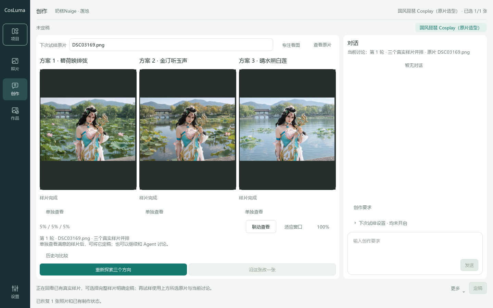

# CosLuma

Cosplay 摄影后期工作台。通过对话制作样片、批量成片，并保留手动精修与版本选择。

[下载 Windows 版](https://github.com/Magnus0100/cosluma/releases/tag/v0.46.0) · [English](README.en.md) · [开始使用](#开始使用) · [部署](#部署) · [许可](LICENSES/README.md)

Windows x64 · 中文界面 · **0.46.0**

| 原片 | 成片 · 开启修发与重打光 |
| :---: | :---: |
|  |  |

出镜：抖音 **「奶糕Naige」**，已授权用于本项目 README 展示。

## 功能

| 功能 | 用法 |
| --- | --- |
| 样片与批量 | 讨论要求，探索三个真实样片；定稿后沿用方向与参考批量制作 |
| 身份保留 | 从原片提取身份区域，整体等比对齐并融合光色 |
| 修发与重打光 | 基础制作的两个独立选项，默认关闭 |
| 光色与人脸 | 固定算法调色；可选美肤与瘦脸，强度从零开始 |
| 头发与衣物 | 在已保存版本上补发、调整发束造型或增加衣物动态 |
| 版本与交付 | 比较、另存、选择交付版本，直接复制已有 PNG / JPEG |

对话与手动控件共用处理入口。浏览、切页和恢复项目只读取记录；生成、另存、采用与导出由用户发起。



## 效果

| 碧荷映绯弦 | 金汀听玉声 | 晴水照白莲 |
| :---: | :---: | :---: |
|  |  |  |

同一原片的三个基础样片，均关闭修发、重打光与人脸美化。

| 仅修发 | 仅人物重打光 |
| :---: | :---: |
|  |  |

这两张沿莲池样片整图改稿，背景也会变化。修发开启时保留原片脸、耳与实体头饰；关闭时保留原片整头。重打光协调人物、服装、道具与环境受光。

<details>
<summary>尺寸与 100% 局部</summary>

例图来自真实制作结果：原片 6000 × 4000，模型原生输出 1536 × 1024，经一次 4 倍模型超分及下采样，保存为 6000 × 4000 的 16 位 PNG 和同结果 JPEG。页面整图为缩略展示，未使用成片后的人脸美化或局部修饰。

未经缩放的 640 × 640 局部：[原片](docs/images/readme/original-face.png) · [基础成片](docs/images/readme/result-face.png) · [仅重打光](docs/images/readme/relight-face.png) · [修发与重打光](docs/images/readme/hair-relight-face.png)。

</details>

## 开始使用

下载 `CosLuma-0.46.0-windows-x64.zip`，完整解压后运行 `CosLuma/CosLuma.exe`。桌面包包含 Python 和图像处理依赖，模型服务与权重另行配置。

| 必需连接 | 要求 |
| --- | --- |
| 摄影助手 | Chat Completions 接口，支持图片、工具调用和 JSON 输出 |
| 图像编辑 | multipart `image[]` 编辑接口，支持原片与风格参考两张图，返回图片 URL 或 `b64_json` |
| 分割与超分 | ComfyUI，提供 SAM3.1、超分模型及标准任务接口 |

1. **建项目**：填写连接，导入照片与角色信息。支持常见图片、HEIC / HEIF 和相机 RAW。
2. **选照片**：勾选制作范围，单独指定代表原片；行高亮只控制预览。
3. **做样片**：讨论要求，按需开启修发、重打光，再探索三个方向。
4. **定稿制作**：采用满意样片，制作勾选照片；默认四张并行，逐张保存结果。
5. **精修交付**：在“作品”中比较和精修，选择交付版本后导出已有文件。

连接设置会按地址与凭据自动获取模型列表，也可手动填写。使用远端服务时，图片与提示词发送至该服务。

### 成片精修

从选中的保存版本打开编辑，结果另存，保留父版本。

| 编辑 | 范围与操作 |
| --- | --- |
| 光色 | 整图曝光、暖冷、绿洋红、饱和度与明度曲线；可对交付勾选照片批量应用 |
| 人脸美化 | 手动选脸并分析，主动生成美肤基础后调整美肤、瘦脸；归零恢复底图 |
| 补发与露网修补 | 细节图加整图上下文，仅写回涂选范围 |
| 发束造型、衣物动态 | 整图生成，按实际新旧部件轮廓提取，再排除原片前景与用户保护区 |

三个局部任务统一使用连接中选择的 Qwen-Image-2.1 或 MiniMax-H3-Image。涂选定位原部件，形状标记与外观参考可选；新轮廓由模型结合完整画面决定。蓝色画笔保护需要保留的区域。

生成后可调整蒙版，主动“按当前范围重新合成”，复用已有输出。修改文字或参考只保存草稿，再次生成需主动发起。衣物动态在成片后单独进行。

## 部署

配置模板：[settings.example.json](providers/settings.example.json)。默认配置为 `~/CosplayWorkbench/config/cosluma.json`，可用 `--config` 或 `COSLUMA_CONFIG` 指定。项目默认保存至 `~/CosLuma/projects/`。模型、照片与私人配置放在仓库外；密钥可使用环境变量或独立文件。

<details>
<summary>模型、权重与推理参数</summary>

基础 ComfyUI 使用 `models/checkpoints/sam3.1_multiplex_fp16.safetensors` 与 `models/upscale_models/4xNomos2_hq_atd.safetensors`。服务缺少 SAM3 文本编码器投影修正时，应用 [对应补丁](providers/patches/comfyui-sam3-clip-projection.patch)。

可选功能需将对应 `providers/comfyui_cosluma_*` 目录复制到服务的 `custom_nodes/`，在服务已有 Python 中安装所需依赖并重启。服务节点需单独更新；权重不随桌面包分发。

| 功能 / 节点目录 | 默认模型与参数 |
| --- | --- |
| 重打光 / `comfyui_cosluma_relight` | PIXLRelight + Marigold-IID-Lighting v1.1；512 分析画布，BF16 网络、单步 FP16 Marigold、float32 光照场，`cuda:0`，seed 42 |
| 美化 / `comfyui_cosluma_beauty` | 完整 BeautyGRPO LoRA + 官方 FluxKontextPipeline；1024 输入，28 步，guidance 2.5，seed 42；FGTBT WFLW 98 点与 FaceXFormer 皮肤解析 |
| 局部编辑 / `comfyui_cosluma_local` | Qwen-Image-2.1 INT8 ConvRot，Qwen3-VL 8B / VAE BF16；1024 面积分辨率，40 步 |
| 局部编辑 / `comfyui_cosluma_h3` | MiniMax-H3-Image INT8 ConvRot，Qwen3-VL 32B NVFP4 AWQ、FP16 VAE；2048 面积分辨率，6 步 |

Qwen / H3 均使用 cfg 1、Euler/simple、seed 42。面积分辨率 1024 / 2048 约为 1 MP / 4 MP；实际请求结合原尺寸范围和一次超分倍率计算。

| 目录 | Qwen 权重 | H3 权重 |
| --- | --- | --- |
| `models/diffusion_models/` | `qwen_image_2.1_int8_convrot.safetensors` | `minimax_h3_image_pruned_int8_convrot.safetensors` |
| `models/text_encoders/` | `qwen3vl_8b_bf16.safetensors` | `qwen3vl_32b_minimax_h3_nvfp4_awq.safetensors` |
| `models/vae/` | `qwen_image_2.1_vae_bf16.safetensors` | `minimax_h3_image_vae_fp16.safetensors` |

局部引擎由 `local_edit.engine` 选择，H3 参数位于 `local_edit.h3`。权重放在 NVMe SSD，通过 ComfyUI 的 `extra_model_paths.yaml` 配置路径。两个引擎使用服务已有 DynamicVRAM，以文件映射加载编码器和扩散权重，按阶段释放模型；Qwen VAE 分块 512、重叠 64，H3 VAE 解码固定 CUDA 驻留。补发整图上下文长边最多 1536。Qwen 接收蒙版参考，H3 不接收蒙版；H3 结果使用梯度域融合。

BeautyGRPO 底座为 `models/diffusers/FLUX.1-Kontext-dev/`，LoRA 为 `models/loras/beautygrpo.safetensors`，分析权重为 `models/cosluma_face/{facexformer,fgtbt}.safetensors`，使用 [FaceXFormer](providers/convert_facexformer.py) / [FGTBT](providers/convert_fgtbt.py) 转换器提取。默认 `beauty.memory=bnb_nf4`：Transformer NF4 / double quant / BF16 计算，完整 BF16 T5 通过 Accelerate CPU offload，CLIP / VAE BF16；`cuda` 为整套显存布局。分析设备由 `beauty.analysis_device` 指定，生成设备为 `cuda:0`。Windows 美化服务设置 `PYTORCH_ALLOC_CONF=backend:native` 与 `PYTORCH_CUDA_ALLOC_CONF=backend:native`，使用 `--disable-dynamic-vram --disable-cuda-malloc`。

重打光目录为 `models/cosluma_relight/pixlrelight`（上游源码、`model.safetensors`、`config.yaml`）及同级 `marigold-iid-lighting-v1-1`；节点另需 `addict==2.4.0` 与 OmegaConf。`relight.device` 可明确选择 `cuda:0` 或 `cpu`。连接中的“模型下载”提供文件与安装命令，各权重许可见 [LICENSES](LICENSES/README.md)。

</details>

<details>
<summary>制作链与图像质量</summary>

基础链：方向与参考 → 提示词编写与独立审查 → 整图生成 → 按需一次超分 → SAM3.1 原片身份提取 → SIFT 整体等比对齐 → MKL 仿色或 PIXLRelight 重打光 → float32 蒙版融合 → 可选明度曲线 → 保存。

桌面与 CLI 共用 [finish_photo / finish_batch](scripts/photo_pipeline.py)。主对话仅调用注册的摄影工具；提示词按 [任务模板](providers/generation_templates.json) 编写并由独立上下文审查，复用摄影助手连接。非生成编辑使用固定算法。应用内部直接调用 Python API，外部模型服务使用 HTTP；失败保留输出与错误，不自动重试或更换模型。

原片只读，默认请求长边 6000。原片身份 RGB 与蒙版同变换采样一次，合成使用 float32，保存带 sRGB 配置的 16 位 PNG 和 8 位 JPEG。模型与部分蒙版含 8 位环节；超分覆盖不足时按实际尺寸保存。整图改稿会改变未指定区域；局部修饰仅写回最终蒙版内。发丝、透明衣料及大幅几何变化仍可能出现分割或融合接缝。

</details>

<details>
<summary>源码运行与构建</summary>

在已有 Python 3.12 中运行，模型服务独立部署：

```powershell
python -m pip install -r scripts/requirements-desktop.txt
python -B scripts/qt_workbench.py
```

CLI 支持 `styles`、`stylize`、`compose`、`beautify`；全局 `--root` 和 `--config` 放在子命令前。桌面包使用 `CosLuma.exe --cli`。构建安装 `scripts/requirements-build.txt` 后运行 `python -m PyInstaller --noconfirm CosLuma.spec`。开发约定见 [AGENTS.md](AGENTS.md)。

</details>

## 许可

代码采用 [GPL-3.0-or-later](LICENSE)，项目不商用、不盈利。第三方代码、模型及权重遵循各自许可，见 [LICENSES/README.md](LICENSES/README.md)。例图、衍生图及截图中的照片仅授权本项目 README 展示，不随代码按 GPL 重新授权。
