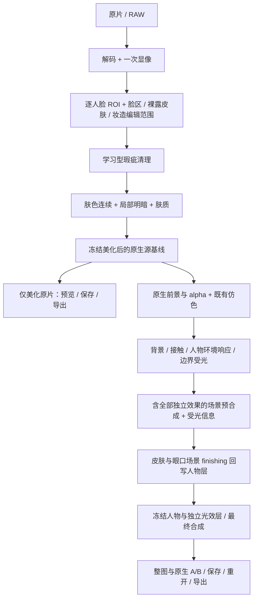

# 下一大版本：Cos 人像美化调研与路线

调研及首轮实验日期 **2026-10-10**，当前生产版本仍为 0.4.8。已查阅论文、官方源码、权重及许可，并完成 SegFace、专用美肤和 BeautyGRPO 的三图真实推理及原始浮点母版回放，独立自动准备入口已跑通。实际范围和使用见 [实跑与回放](PORTRAIT_BEAUTY_POC.md)；同人物/场次三图不证明 Cos 泛化，最终默认模型未定。

下一版应新增三条制作路线共用的**学习型人像精修**：自动处理临时瑕疵、肤色不连续与肤质，同时保留本人、角色妆造和场景受光。已有仿色、纹理恢复或滤波不能算作这个新增组件。本次调研未找到公开证据充分、同时覆盖全身 Cos、浓妆、美瞳、高清细节和背景融合的统一模型，必须按任务选型。

## 现状为什么做不好

| 现有能力 | 实际缺口 | 下一版的方法 |
|---|---|---|
| [源精修生产者](../scripts/native_retouch_producer.py) | 紧凑亮度异常和同材质供体处理小瑕疵/衣物杂屑，没有完整皮肤精修；不能区分所有痣、妆纹和皮肤问题 | 加入专门学习型缺陷定位、局部修复和肤质/匀肤组件，同输入比较真实净收益 |
| [自动源精修](../scripts/automatic_native_retouch.py) | 对候选和供体逐项联网确认，常规美化依赖多次小请求，容易检查很多却没有明显改善 | 基本美化离线一次准备；集中审片和局部恢复保留为用户可用操作 |
| [单源制作入口](../scripts/single_source_workflow.py) | 自动精修依赖参考、设计状态和文本视觉许可；本地原片路线没有调用同一自动美化能力 | 本地原片、已有参考、创作参考共用 beauty producer，只按能力声明依赖 |
| [脸部保护](../scripts/local_face_protection_worker.py) | 单脸设置；缺关键点时保护范围扩大；几何、纹理和颜色权限混用 | 多人物逐脸分析；分开编辑权限，眼口接受正常场景受光 |
| 人体语义与细节恢复 | 手臂/身体位置标签不证明裸露皮肤；恢复原片亮度结构不等于改善肤质 | 独立判定皮肤材质，纹理载体来自已清理原片 |
| 人物环境协调 | 当前主要覆盖可靠对应的头发/衣服，不能完整解决皮肤和眼口光色 | 源美化与场景相关 finishing 分工，避免后段美化把环境光提白或抹掉 |

这些是能力和入口缺口，不能通过增加检查数量、改算法名称或调整某一张图的阈值解决。当前功能范围见 [算法选择与范围](ALGORITHM_DECISIONS.md)。

## 两轮独立专家讨论

本次由三个独立 subagent 分别承担用户/产品、学术研究、工程审查；各组补充下列立场。第一轮独立提出问题与方案，第二轮交换模型证据、入口缺口和冲突后交叉评审。下面的结论是讨论收敛结果，尚不是模型效果验证。

| 立场 | 除“皮肤更好看”外，还必须考虑 |
|---|---|
| Cos 用户 | 像本人、像角色；美瞳、眼线、唇线、假发和服装可辨认；整图亮度与气氛合理 |
| 专业修图师 | 真正省去祛痘、匀色和局部明暗劳动；100% 可看、分层可调、局部可恢复 |
| 妆造师 | 绘制雀斑、眼影、身体彩绘和特殊肤色不是自动删除对象；不能将全部眼口颜色冻结 |
| 摄影师 | 骨相阴影、亮部层次和光源方向成立；脸颈手臂与背景相融，边界受光保留 |
| 批量用户 | 共享审美意图，每图独立区域；避免只修好一张示例或直接复用另一张遮罩 |
| 产品经理 | 默认一键、少量意图控制、离线基础能力；用户直接比较画面，不填模型阈值表 |
| 算法专家 | 瑕疵、肤质、仿色、修复、重光照任务分开；论文排名须注明数据集和适用范围 |
| 渲染工程师 | 原生坐标、高位母版、明确色域、一次显像、冻结回放；低分辨率预测不冒充高清重建 |
| 开源维护者 | 权重来源、运行时、Windows 路径和各自许可可复现；一个清楚的默认后端，避免无条件串联大模型 |
| 质量负责人 | 正常观看和原尺寸都有净收益；记录失败与未处理区域，不能把零改动称为精修成功 |

第二轮解决了五项分歧：

1. **不能只交付传统过滤。** 专门学习型精修是 P0；经典源修补只是基线和局部辅助，不包装成 SOTA。
2. **最新论文和成熟基线并行。** BeautyGRPO 是近期学术质量对照，ModelScope 专用美肤是可复现工程基线；二者必须实际对照后决定默认，不因年份或许可标签提前宣布获胜。
3. **保护作用类型，不冻结整个脸。** 默认不改几何和角色图案；皮肤、眼周阴影、眼白和唇妆分别接受合理受光，不能统一套皮肤目标色。
4. **原片美化在仿色前，环境 finishing 在融合后。** 前段处理瑕疵/肤质，后段处理场景相关皮肤与眼口响应，不能重复磨皮或独立提白脸。
5. **默认自动，允许局部纠正。** 不要求逐痘审批、逐图画遮罩或找供体；可靠区域处理，争议区域可恢复。草稿可以导出并标为未审，人工接受单独记录。

仍未达成事实结论的事项：哪个模型在真实 Cos 中最好、默认精修强度、生成式候选是否损伤妆造、16 GB 显存能否运行新模型、全身小脸和身体皮肤的收益。这些进入实验，不能由会议替代。

## 算法候选与证据

“SOTA”只引用其论文/官方报告针对的任务，不能推广为本软件已经达到 SOTA。下表把论文、可复现性和产品选择分开。

| 候选 / 来源 | 真正任务与方法 | 代码 / 权重 / 许可现状 | 本轮决定 |
|---|---|---|---|
| **[BeautyGRPO](https://github.com/vivoCameraResearch/BeautyGRPO)，CVPR 2026 Highlight**；[论文](https://arxiv.org/abs/2603.01163) | 专门脸部精修；细粒度偏好学习，DPG 用于训练探索，部署采用标准 ODE；针对微瑕疵、纹理和身份保持 | 推理与 [LoRA](https://huggingface.co/Sehnsucht24/BeautyGRPO) 已下载并实际加载；底模 FLUX.1-Kontext-dev 已授权并校验。README 声明 MIT 但固定源码缺独立 LICENSE；LoRA 元数据未声明单独权重条款，底模条款独立 | **PoC-B，近期 SOTA 对照已实跑**；首轮原始输出改动美瞳/妆线，原生受限收益偏轻，默认与发行配置未定 |
| **[ModelScope 专用美肤](https://modelscope.cn/models/damo/cv_unet_skin-retouching/summary)**；[ABPN，CVPR 2022](https://openaccess.thecvf.com/content/CVPR2022/html/Lei_ABPN_Adaptive_Blend_Pyramid_Network_for_Real-Time_Local_Retouching_of_CVPR_2022_paper.html) | 实装是多模型：U-Net 预测 blend 图匀肤，缺陷分割 + inpainting 去瑕疵，皮肤分割 + 美白；不等同单一原版 ABPN | 四个权重公开；官方模型条目标 Apache-2.0，框架 Apache-2.0，附加 RetinaFace 模型条目标 MIT。Torch/TF 混合依赖，第三方来源需登记 | **PoC-A，可复现学习型基线**；分离美白、匀肤和修复后验证，明确不是最新 SOTA |
| **[SegFace](https://github.com/Kartik-3004/SegFace)，AAAI 2025** | 长尾脸部语义解析；类专用 token + 多尺度特征，官方报告 LaPa / CelebAMask-HQ 改善 | 固定 MIT 代码及模型卡条款已登记，512 CelebAMask-HQ checkpoint 已完整严格加载，三图实跑 | **脸区解析 PoC**；实测遮挡语义误判需原坐标资格约束，不替代全身语义或原生抠图 |
| **[FaceXFormer](https://github.com/Kartik-3004/facexformer)，ICCV 2025** | 统一脸部分析，含 parsing、landmark、head pose、visibility 等九任务；不是美化器 | MIT 代码与公开 HF 权重入口 | 候补基础分析方案；仅评估需要的解析/关键点/可见性，不为产品增加无关人物属性推断 |
| **[RetouchFormer](https://github.com/Davidcoach/RetouchFormer_AAAI_24)，AAAI 2024** | soft inpainting、瑕疵预测与 clean-face prior 的选择性自注意力，专门局部瑕疵 | 官方权重入口存在；未见明确仓库/权重许可 | 第三对照，验证局部性；不列入当前默认依赖 |
| **[RetouchGPT](https://github.com/Davidcoach/RetouchGPT)，AAAI 2025** | 指令条件的缺陷定位与局部修复，不是普通仿色模型 | MIT 代码，权重百度入口；配置 JSON 有语法缺陷，源码 CUDA 硬绑定；Llama-3.1-8B + Flan-T5-Large，权重授权未核实 | 研究候补。官方 LLM 为 fp32，8B 参数仅理论存储约 32 GB，不能称轻量即插即用；无本机运行成绩 |
| **[Face Retouching with Diffusion Data Generation and Spectral Restorement](https://openaccess.thecvf.com/content/ICCV2025/html/Xu_Face_Retouching_with_Diffusion_Data_Generation_and_Spectral_Restorement_ICCV_2025_paper.html)，ICCV 2025** | 合成 25,000 对训练样本；频率选择/恢复 FSR 与多分辨率融合 MRF，处理全局连续性与局部细节的冲突 | 官方论文页确认任务、方法及基准结论，未提供可确认的代码/权重链接 | 频带保真路线的重要学术对照；先确认复现材料，不冒称已有可安装模型 |
| **[Lightweight Additive Blend Maps](https://ojs.aaai.org/index.php/AAAI/article/view/41481)，2026-03-14** | 小 U-Net 预测像素 dodge/burn 增量，不重建整脸；官方摘要声明模型 6 MB | 作者 Abinash Pegu；实际为卷 40(47) 的 **IAAI Emerging Applications 轨**，不是 AAAI 主会 SOTA；官方页面未提供已确认代码/权重 | 纹理保留与可训练残差架构依据；不是现成可安装组件 |
| **[DiffRetouch](https://github.com/Adam-duan/DiffRetouch)，AAAI 2025** | 学习专家照片色调/外观修饰，Adobe5K / PPR10K，非专门祛痘/肤质模型 | 代码/权重入口；Pi-Lab License 1.0 仅许可非商业用途，商用需另行授权 | 仿色研究对照，不能替代本轮 P0；代码整合与现有 GPL 发行须分别审查 |
| **[MirrorPPR](https://github.com/SJTU-DENG-Lab/MirrorPPR)，2026 预印本**；[论文](https://arxiv.org/abs/2606.29308) | 从示例 before/after 学习细微脸/身体结构操作；DiT + LoRA | 公开 Face checkpoint / benchmark / 47M 数据入口，仓库授权未确认；依赖 Qwen-Image 等 | 主动结构编辑的未来研究，默认保本人骨相时不进入 P0 |
| **[PALATE](https://arxiv.org/abs/2608.18622)，2026 预印本** | 固定编辑器，个性化排序美化候选；不是生成/精修算法 | 本轮核实论文，未确认可部署代码/权重 | 后续个人偏好和批量风格研究，不阻塞基本精修 |
| **[PPR10K](https://github.com/csjliang/PPR10K)，CVPR 2021** | 人像照片专家修图、人区域及组一致性评估 | 仓库 Apache-2.0；数据图像条款独立 | 评估仿色/同组一致性，不能单独衡量祛痘、毛孔或 Cos 妆造 |

SegFace 的 19/11 类标签不等于识别美瞳图案、眼线设计、痣和绘制雀斑。敏感细节还需要原片结构、局部定位及可纠正区域；对此不能作超出模型标签的承诺。当前 Sapiens2 / SAM3.1 / DINOv3 的职责继续分别是人体语义、实例、对应，不以新增脸区解析替换它们。

### 与融合有关，但不属于皮肤美化的研究

| 候选 / 来源 | 适用性与缺口 | 决定 |
|---|---|---|
| [IC-Light](https://github.com/lllyasviel/IC-Light) | 前景/背景条件的生成式重光照；代码 Apache-2.0，底模/权重独立；可能改变五官、服饰和纹理 | 单独可选实验，不串联为默认磨皮器，也不替代原生边界高光层 |
| [COMPOSE](https://arxiv.org/abs/2408.13922) | ambient + Gaussian 主光分解，光估计、diffuse、阴影生成和编辑四阶段；保留环境气氛并控制面部阴影。本轮全文/项目检索未核实代码/权重 | 面部阴影研究依据，不能声称解决发丝/肩袖的窄高光 |
| [SynthLight](https://vrroom.github.io/synthlight/)；[论文](https://arxiv.org/abs/2501.09756)，CVPR 2025 | HDR 环境图条件、合成人脸训练的重渲染；展示皮肤高光、发丝 rim 和一定域外泛化。官方项目未提供算法代码/权重；网站许可不是模型许可 | 光照研究对照；全身 Cos 衣物/假发/饰品未验收，不进入版本关键依赖 |
| [Lite2Relight](https://vcai.mpi-inf.mpg.de/projects/Lite2Relight/) / [代码](https://github.com/prraoo/lite2relight) | EG3D 头部预处理 + HDR 环境图；公开预训练入口，官方 Linux 环境，未确认许可。覆盖头部，不等于整个人物和衣服 | 可复现头部重光照研究候选，先审许可/平台；不作为全身融合答案 |
| GFPGAN / CodeFormer / 通用人脸超分 | 低清或受损人脸恢复；清晰原片上可能换皮肤纹理、妆造和身份。CodeFormer 的 S-Lab 许可另有限制 | 恢复与美化分开；不对清晰 Cos 原片默认整脸重建 |

已有 BiRefNet → 原生 ViTMatte → PyMatting 保留。MODNet/P3M 是人像抠图对照，不因本次美化调研再叠一条抠图主路径。StyleRetoucher 等未核实交付条件的论文保留研究范围；名称相近但任务不明的 SkinFormer、不相关仓库和单纯封装库不列作美化 SOTA。

## 首先怎样验证算法

### PoC-A：实际专用美肤，而不是再做一次滤波

[官方推理源码](https://github.com/modelscope/modelscope/blob/master/modelscope/pipelines/cv/skin_retouching_pipeline.py)已确认：`whitening=True`、白度 `.8` 和修饰强度固定在 `forward` 内，没有已核实的公开关闭参数；直接 pipeline 返回 uint8 BGR。不能原样接入高位母版。

必须分离缺陷定位、修复、blend 匀肤和美白中间结果，**美白默认关闭**。关闭要发生在美白步骤之前，不能对最终白图减平均颜色冒充关闭。默认自然精修不应把脸、颈、手臂统一提白。

匀肤预测的 blend 图在一致 sRGB 域作用于原生源像素，而不是用缩小脸的全部 RGB 覆盖母版。官方曲线为 `y = (1 − 2p)x² + 2px`；预测场上采样、语义范围及强度必须同原片对照。瑕疵检测使用 768 代理、修复使用 512 patch 是实际源码行为，不说明在大脸上能恢复真实原生毛孔。

局部修复保存 mask 和残差；更细纹理来自已清理原片或合格原生局部供体。不能把被删痘点当纹理加回来。公开模型本身会处理痣，故自然标记/妆造误删是首要实验风险，不能相信宣传的“只处理皮肤”已经解决 Cos 语义。

### PoC-B：BeautyGRPO 完整输出与原生适配双对照

官方默认 1024 输入/输出、28 步、guidance 2.5 是发布配置，不是本机性能。公开推理会把图拉伸至方形，且 LoRA 加载失败后捕获异常继续运行纯底模。研究适配必须：

- 使用逐脸原坐标 ROI、保比例 padding 和可逆映射，禁止全身图直接拉伸输入。
- 加载失败立即明确失败；确认有效底模、LoRA 文件身份和加载结果，避免误把纯 FLUX 当 BeautyGRPO。
- 先复现官方结果，再比较源坐标局部残差版本；同时保存两者，检查适配是否抹掉真实美化收益。
- 实看本人特征、妆线、美瞳、假发边界和受光。低分辨率生成脸不能直接放大覆盖高清母版，任何重建纹理标明来源和支持范围。
- 在本机测可运行配置、峰值显存与时间；官方全 bf16 CUDA 路径没有已验证的 offload/量化。改变推理路径后的质量须重新对照。

如果 A 有明显能力缺口且 B 有净收益，优先解决 B 的原生适配、运行与授权；如果 B 改身份或不能交付，继续比较局部修复路线。不能因为 A 易接入就停止研究，也不能因 B 名称最新而强行采用。

## 推荐数据流

解析可以复用源图分析，但作用在像素上的美化必须位于一次显像之后、冻结美化基线之前。场景 finishing 读取含全部独立效果、实际遮挡和边界光的完整预合成及设计受光信息，增量回写人物层，再做最终合成；不能只看没有前景光效的半成品，也不在合并图上统一磨皮。参考负责目标光色/场景，原片负责身份、几何和真实纹理；独立发光层不改变人物覆盖率。背景柱子或亮物体不能仅凭显著性被当作照明证据。

模型多在 sRGB/JPEG 域训练。临时编码供推理，输出解码回 `display_linear_sRGB`，冻结 `Δ = decode(model_output) − input_display_linear`。不能把 sRGB RGB 差直接加到 RAW scene-linear。母版精度和模型采样精度分别记录，TIFF16 导出不代表模型生成了 16 位原生细节。

对全脸连续场保留全脸上下文；对局部缺陷使用原生 patch。模型能否正确 tile 必须实验，重叠羽化本身不证明连续光色正确。先清理，再用已清理的纹理；美化上游变化仅重做相关仿色/环境依赖。

### 编辑权限和最少新增模块

| 权限 | 默认行为 |
|---|---|
| 几何 | 不改五官比例、表情、骨相和人体轮廓 |
| 色素 / 妆造 | 保妆线、彩绘、美瞳图案和自然标记；允许合理环境光色变化 |
| 纹理 | 皮肤按任务管理；发丝、衣纹、金属不进入磨皮；真实与重建纹理分记 |
| 覆盖率 | beauty 不输出 alpha，人物不因美化或光层变透明 |

新增范围收敛为：`region map`、`beauty producer`、冻结 `beauty runtime` 和按能力的模型配置。复用现有图层、强度、ROI、撤销、批量、保存及 portable 合同，不重建一套逐层联网 QA。

建议统一结果 `portrait_beauty_result.v1`，输出瑕疵修复、匀肤/明暗场、肤质差值三个可独立控制资产，绑定源/显像身份、ROI 变换、实际 mask、模型/权重/代码身份、参数、工作域和上游依赖。准备时推理，预览、保存、重开消费冻结资产。

失败按区域和模块处理：痣/妆纹不明时只跳过该点；关键点不足不冻结整个脸；纹理层失败不撤销可靠匀肤；场景光失败不丢弃已获得的美化。模型未运行或全部候选无收益时明确显示未完成，普通去噪不能代替学习型美化状态。新路径通过后，旧“异常候选 → 逐点在线批准 → 克隆”退出自动美化主流程，手工修补仍是有效编辑工具。

## 产品范围与明确里程碑

默认流程：导入 → 选择精修程度与需保留标记 → 本图自动分析/本地准备 → 原片 / 仅美化 / 完整 Cos 三向对照 → 保存或继续局部编辑。首屏不要求模型提示词、阈值或手工画脸；高级页保留独立强度和局部恢复。

| 阶段 | 必须交付 | 通过条件 |
|---|---|---|
| **M0：选型实跑，A/B 并行** | SegFace + PoC-A 的完整对照；PoC-B 独立复现及资源/授权核实；先用 12–20 张高价值 Cos 图，记录运行配置、时间/峰值显存与失败类型 | A 的美白确实关闭，原生收益可检查后即可进入 M1；B 成功须证实 LoRA 加载并对照官方/适配输出，受阻则保留具体障碍和未完成状态，不阻断 A，也不称 SOTA 实测完成 |
| **M1：本地美化闭环** | 学习型瑕疵、肤质、匀肤/明暗独立层；一键准备、A/B、局部恢复、保存重开、高位导出 | 离线原片入口有实际净收益，保存图与预览一致；不是只有模型调用成功或零改动 |
| **M2：Cos / 全身 / 多人物** | 浓妆、美瞳、彩绘、假发、侧脸、遮挡、不同肤色、手套、身体皮肤与多人；逐图分析 | 妆造和材质不误改，脸颈手臂过渡连续；不宣称没有验证的身体范围 |
| **M3：完整流水线** | 三路线共用美化源；肤色/眼口场景 finishing；现有仿色、边界光和效果接入 | 眼口不新增怪色，人不变黑/透明，发丝肩袖受光不消失；正常观看与原生细节都比当前版有净收益 |
| **M4：批量与发布** | 扩展跨人物/场次持出集；同场共享意图；Windows 安装、CPU 冻结重开、模型说明和许可 | 不靠同一图调参获得结论；盲评、失败范围和实际软件闭环可复查，再发布下一大版本 |

P0 是瑕疵、肤质、局部匀色/明暗、三路线共用与可编辑闭环。P1 是有限眼唇牙增强、同组风格和适用范围明确的低清恢复。P2 才是默认关闭的结构美化、参考妆容迁移、个性偏好学习和生成式重光照；它们不阻塞基础精修。

本机为 RTX 4080 SUPER 16 GB，约 61.6 GiB RAM。GPU 模型串行驻留，CPU 解码/写出可并行，新增资产优先稀疏 ROI。SegFace 实测峰值约 0.61 GB，专用美肤约 0.64–1.25 GB allocated；BeautyGRPO 在 sequential CPU offload 下约 2.57 GB allocated，首轮采样约 187–317 秒/图，首次加载约 63 秒。这是各自 worker 的实测，不含完整桌面流程。官方 FPS、服务配置和推理步数不能当作本机承诺。

## 视觉验收与发行边界

评测同时比较当前版本、学习型基线和 SOTA 候选，包含原片/仅美化/完整合成。按人物与场次分开调试和持出，不只检查同一场次相邻照片。对瑕疵改善、肤色连续、皮肤质感、妆造/身份、光色和完整性分别记录改善、退步和未处理范围。

自动应用必须拒绝新增五官/美瞳/妆线变化、人物透明或缺失、眼口色环、塑料皮肤、明显重复补丁、全脸提白及边界光退步的候选。频繁失败的算法不进默认。局部不确定可以保源，但大面积长期无处理表示功能未完成。

身份 embedding、关键点位移、纹理频带、色差和 LPIPS 只作诊断；阈值需在 Cos 妆造样本校准，不能单个分数批准艺术效果。用户正常观看的自然度与 100% 细节对照是共同依据。模型推理成功、工程保存成功和艺术接受是三个不同事实。

代码、权重、底模、第三方依赖及数据图像分别核实许可。开源不等于商用授权；非商业条款不等于禁止一切研究或公开代码。通用 adapter 的公开、模型配置推荐、权重再分发和商业使用分别判断，不以“用户自行下载”规避条款，也不把自定义许可一概当作非商业。未经确认的模型不标为已获无限制发行/商用授权。

当前已从调研推进到 **M0 的真实同输入推理对照**；独立工具不更改 0.4.8 生产入口。首轮基线收益较轻，遮挡解析已暴露并修正实际误编辑问题；后续按对照的净收益选择后端进入 M1，不能仅凭加载成功授予视觉通过。

两套美化模型各完成原头部上下文与统一完整脸上下文的三图对照，已保存原始候选、限定原生回放、原生细节及失败结论。裁切改进了检测采样，尚未获得稳定明显的整体美化收益；当前默认后端没有验收。M0 的三图工程可运行性已确认，12–20 张高价值样本、独立人物/场次与已知任务校准仍需补齐，再进入默认选型与 M1 产品集成。
